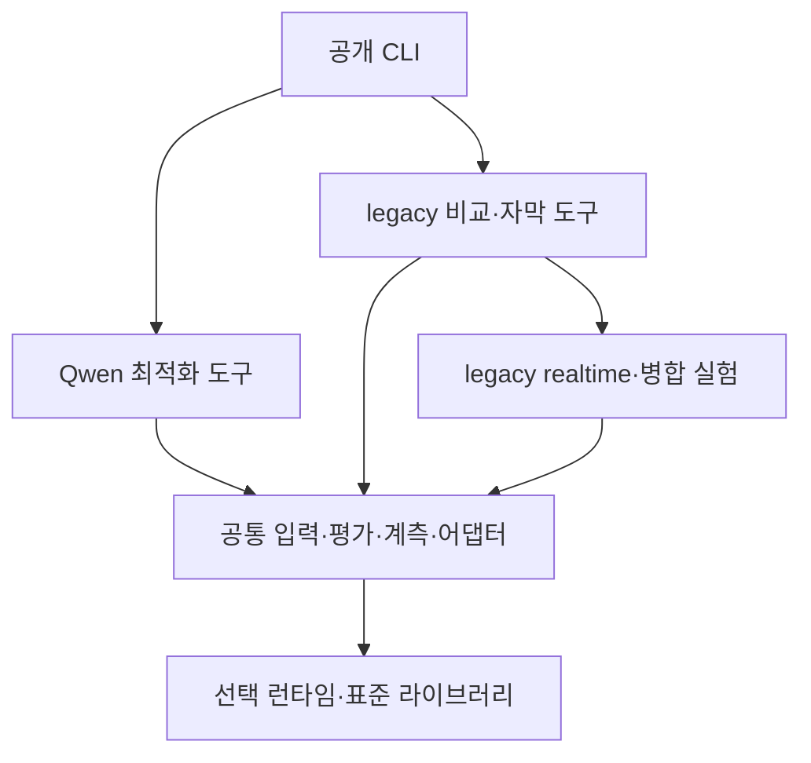

# 코드 구조와 확장 경계

공통 평가 기반 위에 Qwen 최적화 도구와 이전 모델 비교 실험을 분리합니다. 세부 경로 변경과 호환 범위는 [구조 이행 안내](structure_migration.md)에 있습니다.

| 영역 | 책임 |
| --- | --- |
| `cli.py`, `tools/cli.py` | 기존 공개 명령, 선택한 구현의 지연 import |
| `adapters/` | Qwen ONNX·Zipformer·SenseVoice의 로딩/발화 상태/전사 계약 |
| `dataset.py`, `config.py`, `audio_policy.py` | manifest·PCM·해시·설정/입력 검증 |
| `evaluation.py`, `scoring.py`, `metrics.py` | 공통 평가·실패 보존·CER/RTF·재채점 |
| `streaming.py`, `segmentation.py`, `vad*.py`, `textgrid.py` | 독립 1배속 입력·큐·구간/문맥·VAD·주석 |
| `artifacts.py`, `resources.py`, `runtime.py`, `diagnostics.py` | 원자적 기록·프로세스 자원·런타임/제한 진단 |
| `thermal.py`, `cooling.py`, `tools/probes/{thermal,load}.py` | 공통 센서·열/시간/메모리 제한·부하 검사 |
| `tools/data/`, `tools/reports/cooling.py`, `tools/maintenance/` | 공통 데이터 준비·냉각 보고·유지보수 |
| `tools/optimization/qwen3.py` | 기존 Qwen 단독 로딩·첫 전사 smoke; 새 프로파일러는 아님 |
| `legacy/realtime/` | 이전 연속 Zip·VAD·Refine IPC·WAV 자막 |
| `legacy/tools/` | 이전 비교/VAD/병합/자막 실행과 저장 원시 집계 |
| `legacy/*.py` | 과거 병합·토큰 정렬·VAD 진단 실험 |
| `benchmark.py` | 초기 Zip 반복 프로브 호환 경로 |

## 의존 방향

공통 코드와 OPT 도구는 legacy를 import하지 않습니다. CLI dispatch만 이전 명령을 연결합니다. 모델/VAD 런타임은 실제 실행 함수 안에서만 import합니다. 보고서는 probe를 import하지 않으며 `legacy/realtime/`은 병합 실험에 의존하지 않습니다. native 런타임 없이 모든 도구의 `--help`와 저장 원시 집계를 사용할 수 있어야 합니다.

어댑터 계약은 `model_files`, `load()`, `transcribe(Audio) -> str`, `close()`입니다. Qwen/SenseVoice는 현재 batch이고 Zipformer는 `start_stream/accept_chunk/finish_stream`도 제공합니다. GGUF·토큰 스트리밍을 위한 미구현 인터페이스는 선제적으로 추가하지 않습니다.

기존 `RefineChannel`의 유한 큐·자식/reader 회수와 자막 JSONL 계약을 유지합니다. 이전 파이프라인의 자세한 사용법은 [legacy 자막](../guides/legacy/live_captions.md)에 있습니다. 이를 새 Qwen 단독 파이프라인으로 간주하지 않습니다.

`artifacts.write_json`은 비유한 값을 거부하는 원자적 체크포인트입니다. 새 실행 경로 확보는 호출자 책임이고 `write_event`는 행마다 flush합니다. strict `read_jsonl`과 강제 종료의 마지막 잘린 행을 허용하는 `streaming.read_events`는 구분합니다. 원시 스키마와 `ko_cer_v1`은 이번 개편에서 바꾸지 않습니다.

기존 `benchmark.digest/write_json/distribution/process_sample`, `evaluation.RssSampler`, `segmentation.pcm_bytes` 호환 경로는 유지합니다. RP5의 `scripts/edge_asr.py`는 현재 체크아웃을 사용하므로 폴더 개편 때문에 환경을 재설치하지 않습니다.
