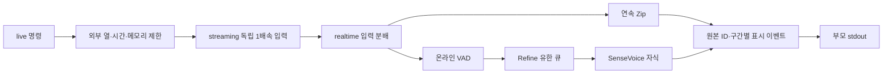

# 코드 구조와 확장 경계

공통 입력·모델 호출·계측을 재사용하고 실행 도구가 이를 조합한다. CLI와 결과 포맷을 유지하며 모델별 처리는 어댑터 안에 둔다.

| 영역 | 책임 |
| --- | --- |
| `cli.py` | env/check-config/evaluate/score/live/tools 진입점·지연 import |
| `adapters/` | Zipformer/SenseVoice/Qwen 로딩·발화별 상태·전사·출력 정책 |
| `dataset.py`, `config.py` | manifest/PCM16/PCM 해시·모델/모드 설정 검증 |
| `evaluation.py`, `scoring.py`, `metrics.py` | 공통 batch/paced 평가·실패 보존·CER/RTF·재채점 |
| `streaming.py` | 독립 입력 프로세스·유한 큐·1배속 시계·백로그 복원 |
| `realtime/replay.py` | 원본 좌표를 유지한 입력 분배·연속 Zip 상태 |
| `realtime/refine.py` | Offline 자식 프로세스·유한 큐·선택적 결과 수신·종료 회수 |
| `realtime/vad.py` | 온라인 VAD 방출을 Refine 큐에 연결 |
| `realtime/captions.py` | 원본/구간 ID 기반 Zip·보정 후보 분리 표시 |
| `segmentation.py`, `audio_policy.py` | 공통 PCM 버퍼·전처리·구간 소유권/문맥 |
| `vad*.py`, `textgrid.py` | VAD 백엔드·진단·주석/음성 구간 검증 |
| `merging.py`, `segment_merge.py`, `token_alignment.py`, `token_splice.py` | 자동 교체/경계 대응의 실험 코드. 현재 자막 기본값과 분리 |
| `artifacts.py`, `resources.py` | JSON/JSONL/체크섬·주 PID 및 프로세스 그룹 CPU/RSS |
| `runtime.py`, `diagnostics.py`, `thermal.py`, `cooling.py` | 런타임·TID·외부 제한 확인·센서/열 정책 |
| `tools/live.py`, `tools/probes/` | 사용자 실행·RP5 실측·외부 실행 제한 |
| `tools/reports/` | 저장 원시 대조·재채점·집계. 새 모델 실행 없음 |
| `tools/data/`, `tools/maintenance/` | 출처/해시를 가진 자료 준비·과거 폴더 통합 |

## WAV 자막 경로

`RefineChannel` 하나가 일반 측정의 결과 파일 저장과 자막/진단의 비동기 결과 반환을 담당한다. `return_results=True`에서는 준비 후 `listen(callback)`을 연결한다. 큐2개·EOF 배출·오류·자식/reader 회수는 같은 구현을 사용한다. 실시간 공통 코드가 실험용 병합 모듈을 import하지 않는다.

자막 이벤트는 JSONL에 쓰고 카운터만 메모리에 보관한다. 같은 긴 부분 전사를 추가 리스트에 누적하지 않는다. 결과 검증은 `tools/reports/captions.py`, 실제 실행은 `tools/live.py`다. 공유 이벤트 쓰기는 `artifacts.write_event`로 통일하며 JSONL 직렬화/flush 계약을 유지한다.

## 의존 방향과 계약

`tools → 공통 패키지 → 표준 라이브러리/선택 모델 런타임` 방향이다. 공통 패키지는 실행 도구를 import하지 않고 보고서도 probe에서 설정을 가져오지 않는다. `realtime/`은 실험 병합 코드와 독립적이다. 테스트에서 이 경계를 검사한다. 추상 기반 클래스·플러그인 검색·별도 서비스 프레임워크는 없다.

어댑터 계약은 `model_files`, `load()`, `transcribe(Audio) -> str`, `close()`다. Zipformer는 `start_stream/accept_chunk/finish_stream`도 제공한다. SenseVoice는 batch만 지원하며 미지원 모드는 실행 전에 거부한다. 새 모델은 어댑터·설정·factory 분기·계약 테스트를 추가한다. 실제 런타임은 모델 실행 함수에서만 import한다.

`artifacts.write_json`은 원자적 체크포인트이며 비유한 값을 거부한다. 호출자가 새 실행 경로를 확보한다. `write_event`는 행마다 flush한다. strict `read_jsonl`과 강제 종료의 잘린 마지막 행을 허용하는 `streaming.read_events`는 사용 목적이 달라 구분한다. [지표 계약](benchmark_design.md)의 정의와 [manifest 명세](../../benchmarks/manifest.md)를 따른다.

CLI/설정/원시 스키마/정규화는 유지한다. 내부 Python import 위치가 바뀌어도 과거 영수증의 명령·커밋·해시는 고치지 않는다. 과거 소스는 해당 Git 커밋으로 재현한다. 기존 명시적 호환 경로 `benchmark.digest/write_json/distribution/process_sample`, `evaluation.RssSampler`, `segmentation.pcm_bytes`는 유지한다. RP5에서는 `scripts/edge_asr.py`가 현재 체크아웃을 사용하므로 재설치가 필요 없다.
