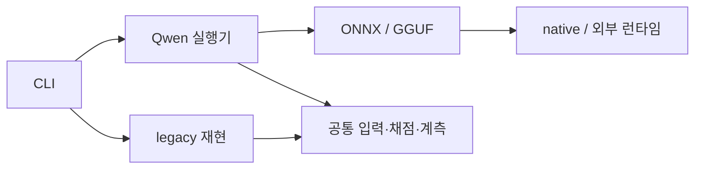
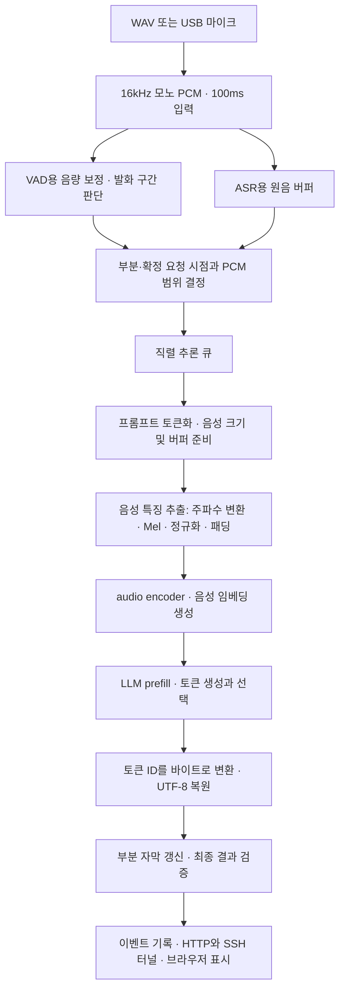

# 코드 구조

현재 작업은 `qwen/`의 Python 실행 경로와 `native/`의 C++ 연결에 모읍니다.

| 위치 | 역할 |
| --- | --- |
| `scripts/edge_asr.py` → `cli.py`, `tools/cli.py` | 공개 명령·선택 구현의 지연 import |
| `qwen/onnx.py`, `qwen/gguf.py` | 모델 로딩·발화 상태·전사·출력 검사 |
| `qwen/convolution.py` | 선택 FP16 합성곱 빌드·preload 계약과 호출별 적용 확인. 기본 경로에는 사용하지 않음 |
| `qwen/benchmark.py` | 모델1회 로딩·첫 추론·워밍업·반복·고정 PCM 재현 |
| `qwen/profiling.py` | ONNX Python/ORT 호출 경계·세션/시계 검증 |
| `qwen/viewer/` | `runs.py`가 실행 상태·프로필 인자·음원 검증, `server.py`가 HTTP/SSH, `web/app.js`가 브라우저 시작, `web/listener.mjs`가 재생·표시를 담당 |
| `qwen/realtime/` | 1배속 실행·VAD 접두 부분 전사·유한 단일 작업자. `stability.py`로 접두부 재표시·문자 철회 집계. 공통 입력·구간 분할 재사용 |
| `native/gguf/`, `native/ort_trace/` | C ABI·ORT 계측과 빌드. [안내](../../native/README.md) |
| `tools/data/` | 데이터 준비·검증·평가 순서 생성 |
| `dataset.py`, `config.py`, `audio_policy.py` | manifest·PCM·해시·설정 검사 |
| `evaluation.py`, `scoring.py`, `metrics.py` | 일반 평가·실패 보존·CER/RTF·재채점 |
| `artifacts.py`, `resources.py`, `runtime.py`, `diagnostics.py` | 원자적 기록·공통 계측·native 경고·런타임 진단 |
| `tools/probes/`, `thermal.py`, `cooling.py` | 열·시간·메모리 제한과 냉각 점검 |
| `streaming.py`, `segmentation.py`, `vad*.py`, `textgrid.py` | 재사용 입력·큐·구간/VAD·주석 기반 |
| `microphone.py` | 모델 독립 ALSA 장치 조회·16kHz 수집·유한 큐·녹음/실패 보존 |
| `adapters/`, `legacy/` | 공통 factory·이전 비교 모델과 자막/병합 재현 |
| `legacy/benchmark_zipformer.py` | M1 Zipformer 전용 반복 프로브. 현재 Qwen의 `qwen/benchmark.py`와 구분 |

고정100개 선정은 `tools/data/fixed100.py`, 긴 발화 선정·연결은 `tools/data/longform.py`가 담당합니다. 두 도구는 `tools/data/zeroth.py`의 고정 원본 정보·archive 읽기·화자/전사/FLAC 후보 생성을 공유합니다. FLEURS에도 쓰는 tar 검사·프레임 보존 PCM 변환과 출처 영수증은 기존 `tools/data/external.py`에 둡니다. 파일 해시·JSON·JSONL은 `artifacts.py`를 직접 사용하고, 입력·TextGrid는 `dataset.py`·`textgrid.py`를 재사용합니다. 각 도구의 선정/연결 규칙·실패 산출물 보존/정리 정책은 각 준비 경로에 유지하며 결과 JSONL은 기존 연속 입력 평가기에 전달합니다. [구성·정답 범위](../research/longform.md).

어댑터 계약은 `model_files`, `load()`, `transcribe(Audio) -> str`, `close()`입니다. 공통 factory는 선택 모델만 import합니다. GGUF는 ctypes로 별도 C ABI에 같은 float PCM을 전달합니다. `realtime/`은 도착한 접두 PCM을 반복 호출해 부분 자막을 갱신합니다. 새 GGUF bridge의 선택적 `transcribe_stream(Audio, on_text)`는 생성 중 텍스트를 임시 배포하며 기존 계약·최종 채점은 유지합니다. 기본 전체 음성 경로는 음성 청크 간 KV를 재사용하지 않습니다. 선택 부분 음성 창은 아래 범위에서 embedding·음성 KV를 재사용하며 전체 encoder의 수치 동등 증분 계산과 구분합니다. [측정 범위](../research/qwen_realtime.md).

GGUF의 선택 설정 `num_threads_batch`는 여러 토큰 prefill과 오디오 인코딩에 적용하고 `num_threads`는 토큰 생성에 적용합니다. 생략하면 기존처럼 같은 값을 쓰며 기존5인자 생성 ABI를 사용합니다. 명시할 때는 `split_threads_v1` 별도 빌드의6인자 생성 함수를 사용하고 반환된 설정을 검사합니다. `audio_threads`는 mtmd 초기화에 전달한 값의 기록이며 별도 runtime getter가 아닙니다.

선택 `cache_text_prefix`는 음성 앞 동일 text KV만 유지하는 별도 GGUF 실험 기능입니다. 기본은 끔이며 명시할 때 `text_prefix_cache_v1` 빌드를 요구합니다. `native/gguf/prefix_cache.h`가 일치/실패 상태를 관리하고 bridge는 그 뒤 KV를 제거합니다. audio/뒤 text/이전 생성 결과는 재계산하며 실패 시 전체 초기화로 돌아갑니다. 앞/뒤 text·audio encoder·embedding 평가 시간을 분리하고 첫 추론/워밍업도 기록합니다. 기존 빌드는 보존하며 현재 공유 개발 설정은 검증한 고정 prefix KV 켬을 사용합니다.

GGUF의 text/audio 정밀도는 별도입니다. 기존 자산 명세 v1은 알려진 audio Q8 해시를 유지합니다. 선택 `audio_quantization=q4_0`은 v2 명세와 고정 BF16 오디오 원본·변환 Q4 해시·기준 Q8 해시를 함께 요구합니다. 새 경로에서도 모델 파일 해시를 실제로 확인하며, 기존 v1 검증을 완화하지 않습니다. 측정 웹은 text와 audio 정밀도를 따로 표시합니다.

연산 진단은 `native/gguf/build.py --profile-operators`의 별도 빌드만 지원합니다. `operator_profile.h`가 공개 node callback을 집계하고, `Qwen3GGUFAdapter.set_operator_profile(bool)`이 기능 명세·심볼·모드·집계 유효성을 확인합니다. 기존 실행 경로와 설정에는 계측을 켜지 않습니다. node별 동기화·graph 분할의 영향을 계측 끔과 비교하며 운영 지연과 분리합니다. [계측 범위](../../native/README.md#gguf-연산별-진단).

토큰 표시의 `hold_replayed_prefix_v1`은 같은 구간의 다른 호출이 이미 보인 원문 접두부를 다시 생성할 때 이전 문자열을 유지합니다. 확장·실제 내용 변경·종료 result는 전달하며 실패 시 임시 문자를 확정하지 않습니다. 원시 토큰은 숨기지 않고 `prefix_replay_suppressed`로 기록합니다. `caption_stability`의 문자 철회량과 자기 최종 전사 일치는 정답 CER·음향 지연과 구분합니다.

가변 후속의 기본 비용 추정은 `total`입니다. 선택 `partial_cost_model=audio`는 같은 작업자의 최근3개 성공 native 계측에서 음성 처리 부분만 입력 길이에 따라 확대합니다. 단계 계측이 없거나 실패하면 기존 추정으로 돌아가며, 첫 요청 보호·유휴 조건·구간당 비용/횟수 예산·최종 우선순위는 유지합니다. [선별 조건](../research/qwen_realtime.md#음성-단계-비용-추정-선별--2026-11-13-사전-조건).

선택 `partial_cost_model=audio_scaled`는 같은 비용 이력에서 입력이 짧아질 때의 음성 비용도 비례 조정합니다. 생성 등 나머지 비용은 줄이지 않으며 기존 `audio` 식·최근 3회·1.2 여유·불완전 계측의 `total` 복귀를 유지합니다. 같은 `DecodeWorker`의 선택 분기이며 별도 실행기·native 변경은 없습니다. [문맥 24개 선별](../research/qwen_realtime.md#음성-비용-축소의-연속-입력-선별--2026-11-16-사전-조건).

공통 코드와 Qwen은 `legacy`를 import하지 않습니다. CLI dispatch는 예외이며 보고서는 실행 probe에 의존하지 않습니다. `write_json`은 원자적 체크포인트, JSONL 이벤트는 행별 보존입니다. 입력·출력/실패·`ko_cer_v1` 계약을 유지하며 Host 모의 검사와 RP5 실제 추론을 구분합니다. [테스트](../../tests/README.md), [경로 이행](structure_migration.md).

새 개발은 [공유 GGUF 설정](../../configs/gguf_realtime.toml)과 [개발 안내](../../CONTRIBUTING.md)에서 시작합니다. CLI 목록은 현재·이전 Qwen 진단·legacy·유지보수로 구분하지만 기존 명령은 같은 실행기로 전달합니다. 환경·외부 바이너리는 [환경 기록](environment.md)에, 모델 없는 자동 검사는 `.github/workflows/host.yml`에 있습니다.

## 실행기·상태와 캐시 범위

`realtime/replay.py`의 `run()`은 입력 준비·모델/세션 실행·종료 자원을 소유합니다. 같은 파일의 `session_snapshot()`은 상태를 읽고 `collect_completed_metrics()`는 기존 `metrics.py`·`stability.py`로 완료 지표를 집계합니다. 정상 입력 배출 직후 지표를 계산한 다음 `session.close()` 뒤 상태를 다시 수집합니다. 예외 경로는 종료 후 상태·실패를 보존하며 완료 지표를 새로 만들지 않습니다. 실패·취소·미표시 결과는 각 기존 지표의 분모를 유지합니다.

`viewer/runs.py`의 `replay_args()`는 자산을 열지 않고 청취 프로필을 기존 replay 인자로 바꿉니다. `Library.state()`가 실행 프로세스의 중단 가능 여부를 판단하고 HTTP handler는 그 snapshot을 전달합니다. `web/listener.mjs`의 `createListener()`는 브라우저 상태와 오디오/화면 동작을 한 수명 안에 유지합니다. Node 테스트는 소스 문자열을 자르거나 코드를 주입하지 않고 이를 직접 import해 같은 버튼·HTTP 응답·오디오 시계 경로를 실행합니다. HTML/CSS/JS/MJS는 wheel에도 포함합니다.

| 경로 | 재사용 범위 | 전체 음성과의 관계 |
| --- | --- | --- |
| 기본 전체 음성 + 고정 text prefix KV | 공유 Q8 설정에서 음성 앞 동일 text KV만 유지. 매 요청 음성 특징·encoder·embedding·음성 KV 재계산 | 원래 전체 음성 경로. 일반/확정 요청도 이 경로 |
| 선택 log-Mel 특징 캐시 | `qwen/feature_cache.py`·`native/gguf/mel_prefix_cache.*`. 정규화 전 일치 특징 프레임만 재사용, 경계·전체 최대값 정규화 재계산 | 비트 동등 검증 대상. 공유 기본 비활성, encoder/음성 KV는 재계산 |
| 선택 부분 음성 창 | `qwen/audio_windows.py`·`native/gguf/audio_window_cache.h`. 완료 창 embedding·음성 LLM KV 접두부 재사용 | 부분 요청만 창별 정규화/padding/attention 문맥을 사용해 부분 전사가 바뀔 수 있음. 일반/확정은 전체 음성 경로 |

작업자·Python 어댑터·native의 cache reset은 각각 구간/요청·실패/취소·계산 상태의 수명을 관리합니다. 호출이 비슷해도 하나로 합치지 않습니다. [모델/청취 설정 색인](../../configs/README.md), [선택 실행 옵션](../guides/qwen3_optimization.md#부분-음성-창-캐시-실험)을 따릅니다.

## Q8 전처리·추론·후처리

2026-11-17, 프로젝트 `542f905`와 실제 빌드의 llama.cpp `7d7f0287530bc8981690f361d8c1627dbae1c99a` 소스를 대조했습니다. 아래는 현재 GGUF Q8 경로입니다. **텍스트 토크나이저는 입력 준비의 일부이며, 음성 특징 추출과 다릅니다.** 확인은 소스·기존 로그 분석이며 새 추론은 실행하지 않았습니다.

### 입력과 전처리

1. **입력 형식:** 파일은 `dataset.load_audio()`가 모노 PCM16/16kHz WAV를 검증하고 float32 파형으로 바꿉니다. WAV 경로에서 리샘플링은 하지 않습니다. USB 마이크는 `microphone.py`가 ALSA `arecord`의 16kHz·모노·S16_LE 출력을 읽습니다. 현재 USB 장치는 직접 16kHz를 지원하지 않아 **ALSA `plughw`에서 변환**합니다. GGUF 어댑터가 리샘플링하지 않는다는 설명과 구분합니다. [환경 기록](environment.md#usb-입력-추가-확인--2026-11-13)
2. **VAD와 ASR 파형 분리:** `CaptionSession` → `SegmentPipeline`이 100ms 블록을 처리하고, VAD에는 512샘플(32ms) 창을 공급합니다. 대표 명령의 `rms26-floor80`은 VAD용 분기에만 적용합니다. ASR 분기는 `identity`로 원래 PCM16 값을 보존하며 구간을 float32로 변환해 전달합니다. 이 음량 보정은 모델의 Mel 정규화와 다릅니다. [음량 정책](../../src/edge_asr/audio_policy.py), [구간 처리](../../src/edge_asr/segmentation.py)
3. **부분/확정 요청:** VAD 좌표와 부분 갱신 정책으로 도착한 PCM 범위를 결정합니다. 직렬 작업자는 대기 중 확정 요청을 우선하고, 부분 요청은 최신 대기로 합칩니다. 기본 경로는 실행 중인 호출을 선점하지 않습니다. 선택 연속 모드의 최종 우선 취소는 토큰 callback 경계에서만 적용합니다. 요청 시점·큐 대기는 전처리 연산 시간과 별도입니다. [세션](../../src/edge_asr/qwen/realtime/session.py), [작업자](../../src/edge_asr/qwen/realtime/worker.py)
4. **텍스트 토큰화:** bridge는 빈 system, 음성 marker가 있는 user, `language Korean<asr_text>`로 시작하는 assistant 프롬프트를 구성합니다. `mtmd_tokenize()`가 텍스트를 모델 어휘의 토큰 ID로 바꾸고 `<|audio_start|>`·`<|audio_end|>`를 붙입니다. **파형을 텍스트 토크나이저에 넣는 것은 아닙니다.** 음성 입력은 별도 파형·특징·임베딩 경로를 탑니다. 고정 prefix KV가 적중해도 현재 구현은 프롬프트 토큰화를 수행하고 모델의 앞 text 평가를 생략합니다. [bridge](../../native/gguf/bridge.cpp)
5. **음성 특징 추출:** 고정 런타임은 16kHz, 400샘플 창(25ms), 160샘플 간격(10ms), 128 Mel 대역입니다. 양끝 반사 패딩 → Hann 창을 포함한 주파수 변환 → 파워 → Mel 필터 → log10 → `max(log_mel, 최대값−8)`과 `(값+4)/4` 정규화 → 100 특징 프레임 배수 패딩 순입니다. 마지막 정규화를 엄밀한 `[-1,1]` 범위 보장으로 해석하지 않습니다. 내부 추론 창은 최대 800 특징 프레임으로 나누며 현재 ASR 구간 상한 5초와는 다른 층위입니다.

주파수 변환을 앞선 대화에서는 FFT라고 통칭했지만, **현재 실제 `mtmd_audio_log_mel()` 경로는 Hann 창을 합친 DFT 행렬과 FP32 행렬곱**을 사용합니다. Mel 필터도 FP32 계산입니다. 같은 파일의 별도 FFT helper를 이번 Qwen 경로의 실행 함수로 혼동하지 않습니다. [특징 추출](https://github.com/ggml-org/llama.cpp/blob/7d7f0287530bc8981690f361d8c1627dbae1c99a/tools/mtmd/mtmd-audio.cpp#L591), [DFT·Mel 계산](https://github.com/ggml-org/llama.cpp/blob/7d7f0287530bc8981690f361d8c1627dbae1c99a/tools/mtmd/mtmd-subcontext.cpp#L314)

### 모델 연산과 후처리

특징값은 encoder의 합성곱·Transformer·투영을 거쳐 음성 임베딩이 됩니다. LLM은 음성 앞 text prefix → 음성 임베딩 → 음성 뒤 text suffix 순으로 평가하며, prefix KV 적중 시 앞 text 평가만 생략합니다. 이어 greedy sampler가 토큰을 선택하고, 선택한 토큰으로 다음 모델 계산을 반복합니다. 그래프의 **`token_decode_s`는 이 신경망 계산이며 글자 복원이 아닙니다.**

생성 중에는 다음 순서로 표시합니다.

1. `llama_token_to_piece()`가 토큰 ID를 바이트 조각으로 바꿉니다. 이는 토큰을 다시 텍스트로 복원하는 단계입니다.
2. Python 증분 UTF-8 decoder가 완전한 문자를 복원하고 누적 문자열을 구성합니다. 한글 한 문자가 토큰 경계에서 나뉘면 바이트가 완성될 때까지 기다립니다.
3. 세션이 같은 구간의 이미 보인 접두부 재생을 보류하고, 확장 또는 실제 내용 변경을 부분 자막으로 전달합니다. 글자를 교정하는 모델이 아니라 표시 규칙입니다.
4. callback 안에서 `jobs.jsonl` 기록·flush와 표시용 표준 출력까지 수행합니다. 따라서 `token_callback_s`는 UTF-8 복원만의 시간이 아닙니다.
5. EOG 종료 뒤 C++ 결과 JSON을 반환하고, Python은 JSON/UTF-8·토큰·성공 종료·스트리밍 결과 일치를 검증합니다. 반복·길이 제한 등 비정상 종료는 실패로 기록합니다. 이 최종 검사까지 기다리지 않고 중간 토큰 자막을 표시할 수 있습니다. [어댑터](../../src/edge_asr/qwen/gguf.py), [표시 규칙](../../src/edge_asr/qwen/realtime/stability.py)

현재 이 경로에는 별도 맞춤법·문장부호 교정 모델이나 ITN 변환을 추가하지 않습니다. 모델이 만든 원문을 표시합니다. `ko_cer_v1`의 NFC·공백/문장부호 제거는 **채점과 사후 분석**에 쓰며 화면의 원문을 바꾸지 않습니다. [채점](../../src/edge_asr/metrics.py)

라이브 화면은 RP5의 JSONL을 HTTP 서버가 읽고, 브라우저가 300ms 간격으로 조회합니다. SSH 터널 전달·조회·화면 렌더링은 모델 후처리와 별도 경로입니다. 300ms는 설정 간격이지 측정된 추가 지연 또는 상한이 아닙니다. [청취 도구](../guides/listener.md)

### 현재 타이머에 들어가는 범위

아래 수치는 [11월 16일 Q8 프로파일](../../results/summaries/optimization/reprofile-q8-20261116.json)의 `budget300`·100개 원음·427호출 합계를 나눈 **호출당 평균**입니다. 토큰당 비용이나 합성곱 최적화 후 수치가 아닙니다.

| 계측 | 평균 | 실제 포함 범위·누락 |
| --- | ---: | --- |
| `preprocess_s` | 0.453ms | native 입력 버퍼·프롬프트 토큰화·특징 크기 준비. 토크나이저 단독 시간은 미분리 |
| `audio_encode_s` | 451.319ms | **지연 계산한 DFT/Mel·정규화·패딩 + encoder 실행**. 순수 모델 encoder만의 시간이 아님 |
| `sampling_s` | 8.785ms | 호출 내 전체 sampler 선택/accept 비용 |
| `token_callback_s` | 6.182ms | 전체 토큰의 Python UTF-8 복원·표시 판단·이벤트 기록/출력 등을 합산 |
| 단계 타이머 밖 호출 잔여 | 0.938ms | 토큰→바이트, 종료/반복 검사, JSON 직렬화/파싱·반환 검사, 기타 호출 경계 등을 합산. 순수 후처리 시간이 아님 |

`mtmd_tokenize()`에서는 특징의 **크기와 버퍼를 먼저 준비**하고 실제 값 계산을 미룹니다. `mtmd_encode_chunk()` → `audio_preproc->compute()`에서 특징을 계산하기 때문에 Mel 비용이 `preprocess_s`가 아니라 `audio_encode_s`에 들어갑니다. [지연 준비](https://github.com/ggml-org/llama.cpp/blob/7d7f0287530bc8981690f361d8c1627dbae1c99a/tools/mtmd/mtmd-audio.cpp#L287), [실제 계산 호출](https://github.com/ggml-org/llama.cpp/blob/7d7f0287530bc8981690f361d8c1627dbae1c99a/tools/mtmd/mtmd.cpp#L2270)

별도의 입력 처리 경로는 100ms 청크 8,912개에서 평균 8.968ms·p95 14.941ms입니다. 이 값에는 VAD·버퍼·요청 판단 등이 묶여 있으며 위 427호출 평균과 더하지 않습니다. 기존 `token_receive_to_publish_s` p95 0.011ms는 **Python 수신→세션의 `published_s` 시각을 찍는 지점**입니다. 그 시각은 표시 판단과 실제 로그 쓰기보다 앞서므로 전체 후처리·로그 전달·브라우저 지연으로 해석하지 않습니다.

다음 세부 계측에서 분리할 항목은 **특징 계산(DFT/Mel·정규화·패딩), 순수 encoder, 토큰화, 토큰→바이트, UTF-8/표시 판단, 기록 I/O, 최종 JSON 처리**입니다. 먼저 고정 PCM으로 각 시간과 전사/token 동등성을 확인하고 계측 오버헤드를 대조해야 합니다. 이번 확인만으로 전처리 비중·DFT 최적화 이득을 추정하지 않습니다.

## 청취 도구

`qwen/viewer/`는 기존 연속 실행 기록을 읽어 모델 조건과 독립적으로 라이브·기록 화면을 제공합니다. `runs.py`는 등록한 manifest의 해시로 원음을 재구성하고 기존 replay/thermal-run을 실행합니다. `analysis.py`는 원음별 지연 정의를 공유하며 웹 서버·추론에 의존하지 않습니다. `web/`은 음원 재생과 표시만 담당합니다. 선택 시작 gate는 입력 생산자 준비 뒤 열리며, 기존 평가에서는 사용하지 않습니다. 서버는 localhost와 SSH 터널로 접근합니다. [사용법·계측 범위](../guides/listener.md).

마이크도 같은 `replay.run`·`CaptionSession`·모델 어댑터·채점을 사용합니다. `microphone.py`가 별도 arecord 프로세스와 수집 스레드·유한 큐로 PCM을 공급하며, 길이 미정 세션은 실제 도착 프레임에서 정상 종료합니다. `worker.input.kind = microphone`으로 파일 입력과 구분합니다. 웹의 입력 종료 파일은 수집만 멈추고 Native 최종 배출을 기다립니다. 녹음 재생은 등록 manifest 대신 저장된 WAV 해시/프레임을 확인하고, 지연은 완료 VAD/ASR 구간으로 집계합니다.

선택 `protect_short_followup`은 같은 `CaptionSession`에서 현재 구간의 성공한 첫 부분 결과가4자 미만일 때만 두 번째 요청의 비용 예산 검사를 예외로 둡니다. token 중간 결과·실패·다른 구간에는 적용하지 않고 유휴/최소 새 음성/최대 횟수/끝 여유는 유지합니다. 메타데이터는 `short-first-budget-v1`, 실제 예외 요청은 `short_followup_budget_override`로 남깁니다. 기본 정책과 최종 음성 분할·native 어댑터는 유지합니다.

기록 재생의 `web/review.mjs`는 원음과 겹치는 이벤트·오디오 종료·마지막 결과 시각을 묶습니다. `listener.mjs`는 Web Audio 재생을 해당 원음 끝에서 중단하되 원래 발행 시각까지 화면 시간을 진행하고 확정 전사를 모아 표시한 뒤 멈춥니다. 다음 원음은 사용자가 선택하며 경계를 넘는 전사는 통째로 표시합니다. 이 기능은 원시·공통 지연 집계·실제 추론/라이브 입력을 변경하지 않습니다.

## 선택 연속 수정 정책

`realtime/continuous.py`는 `partial_mode=continuous`에서 최신 활성 범위 하나만 보관합니다. 입력과 작업자의 Condition은 같은 RLock을 사용합니다. 입력 수집은 추론과 독립적이며 파이프라인 갱신·범위 선택·PCM snapshot만 직렬화합니다. 작업자는 확정 FIFO를 먼저 배출하고, 유휴·완료 직후·새 입력·온도 갱신 알림에서 후보를 재검토합니다. 실제 실행 직전 한 번만 기존 PCM ring을 읽고 float PCM으로 변환합니다. 실행 중 입력이 바뀌어도 해당 snapshot은 독립적입니다.

최소 새 음성량은 마지막 실행 범위 끝부터 계산합니다. 횟수/누적 비용 예산은 쓰지 않으며, 완료까지 기다리는 처리 시간·최신 입력·최종 큐로 요청을 합칩니다. 구간 끝 여유는 기본 0.2초, 허용 최대 0.5초이며 추정 호출 비용을 더해 여러 초를 차단하지 않습니다. 기존 bounded final FIFO가 넘치면 명시적으로 실패하며 입력을 몰래 버리거나 속도를 늦추지 않습니다. 최대 5초 내부 확정 뒤 과거 확정 문장까지 수정하지는 않습니다.

열 표본은 별도 스레드가 1초마다 락 밖에서 읽습니다. 기존 `partial_thermal_policy=pause`는 현재 제한 플래그 또는 82°C 이상/계측 결측이면 신규 partial을 보류하고, 현재 제한이 없어지고 78°C 이하이면 회복합니다. 과거 sticky bit는 회복을 막지 않습니다. 종료 시 미회복 시간도 기록하며 final은 기존 thermal-run 보호 안에서 계속 우선 처리합니다. 팬·클럭·전압 설정은 바꾸지 않습니다.

선택 `partial_thermal_policy=pace`는 열 제한 비트를 후속 간격 조절에 사용하며 저전압·결측·예외 고온만 완전 보류합니다. `continuous_policy=paced`는 완료된 모든 추론의 실제 wall 비용을 누적하고 시간 경과로 차감하며, 새 구간에서도 남은 비용을 유지합니다. 작업자의 Condition timeout으로 계산 대기 만료를 깨워 입력이 잠시 없어도 최신 후보를 실행합니다. 최근 비용에 따른 확정 예약은 최대0.8초, 최종 대기에 의한 토큰 취소는0.35초 유예합니다. [정책 수치·실행 옵션](../guides/qwen3_optimization.md#고정-냉각-조건의-지속-부하-조절).

`continuous_policy=headroom`은 작업자가 빌 때 가장 최근 PCM 하나를 선택합니다. 최근 부분 호출의 입력 길이와 실측 비용으로 다음 처리 시간을 추정하고, 그 시간과 끝 여백을 더한 값보다 5초 상한까지 남은 음성이 길 때 시작합니다. 이력이 없으면 새 음성 최소량을 비용 초깃값으로 씁니다. 실제 발화가 먼저 끝나면 대기 후보를 폐기하고, 확정 대기 시 실행 중인 부분 생성은 선택한 토큰 취소 옵션을 따릅니다. [Q8 가변 갱신 프로필](../../configs/listener_q8_headroom.toml)

선택 정책 `headroom_followup`은 위 스케줄러가 끝 여유 부족으로 보류하는 후속 요청에 한해 구간당 한 번 시간을 다시 추정합니다. 현재 구간에서 실제로 표시된 직전 성공 부분 호출의 첫 토큰 시간과 직렬 decode 합계(EOG 선택 포함)에, 새 프레임 비율만큼 확장한 encoder·embedding 평가 비용을 더합니다. 이 시간과 기존 끝 여백이 실제로 도착한 프레임 기준 최대 구간 종료까지 남은 시간보다 작으면 최신 PCM을 전사합니다. 예측 대상은 직전 문구를 다시 생성한 뒤의 다음 토큰입니다. UTF-8 완성·실제 변경 여부·자연스러운 VAD 조기 종료는 실행에 따라 달라집니다. 열 보류·새 음성 최소량·확정 큐 우선권을 적용하고, 확정이 대기하면 다음 토큰 경계에서 취소합니다. `partial_decision`에 예측 시간·남은 시간·추가 허용 여부를 기록합니다. [실험 프로필](../../configs/listener_q8_headroom_followup.toml).

연속 모드의 segment/job revision 및 token 순서는 오래된 이벤트를 거부합니다. 기존 접두부 재표시 보류를 유지하면서 같은 길이 변경·삭제를 허용하고, 빈 partial은 실패를 보존하되 이전 표시를 지우지 않습니다. `viewer/web/captions.mjs`는 최근 확정 2구간과 미확정 결과를 이어 표시하며 전체 확정 이력·원음별 확인은 유지합니다. 음성 encoder/LLM의 증분 계산이 아니라 연속 입력에 대한 최신 접두 PCM 재전사입니다. 기본은 기존 고정 text prefix KV만 재사용합니다.

선택 `qwen/feature_cache.py`와 `native/gguf/mel_prefix_cache.{h,cpp}`는 정규화 전 log-Mel의 비트 동일 입력 창만 재사용합니다. 모델/설정/구간/오류 수명을 검증하고 경계 및 전체 최대값 정규화는 원래 계산을 유지합니다. Transformer/음성 KV/합성곱 출력 캐시는 추가하지 않았습니다. verify 모드는 전체 재계산과 비교해 불일치 때 원래 출력을 사용하며, 연속 정책의 기본에는 켜지 않습니다.

## 선택 부분 음성 창

`qwen/audio_windows.py`는 요청 단위로만 `partial_audio_window_v1`/`partial_audio_window_ms_v1` ABI를 활성화합니다. `realtime/worker.py`의 부분/확정 구분과 기존 구간별 캐시 수명을 재사용합니다. `native/gguf/audio_window_cache.h`는5초 이내 PCM의 완료 창을 바이트 비교하고 embedding을 보관합니다. bridge는 완료 창의 LLM KV 접두부만 유지하고 나머지를 재평가합니다. 일반/확정 호출에는 기존 전체 음성 경로를 적용합니다. 창별 처리로 모델 입력 의미가 달라지는 선택 실험이며 정확도 동등성은 전제하지 않습니다.

## 선택 토큰 후보 검증

`native/gguf/token_draft.h`는 음성 cache와 별개로 이전 부분 토큰을 Q8 greedy 생성의 후보로 검증합니다. setter에서 다음 호출의 후보를 공급하고 바로 소비하며, 새 전체 음성 prefill·Q8 logits로 수락 여부를 결정합니다. 불일치 뒤 KV를 제거하고 원래 생성으로 복귀합니다. [진단 ABI·계측](../../native/README.md#토큰-후보-묶음-검증-진단).

선택 `final_token_draft_block`은 `qwen/token_drafts.py`의 bounded 한 항목 후보 수명을 활성화합니다. `realtime/worker.py`가 기존 작업 메타데이터의 복사본을 어댑터에 전달하며, 같은 segment/start·더 이전 job/revision·도착 음성 범위를 확인합니다. 성공 또는 native가 확인한 협력적 취소 부분 호출만 저장하고, 확정/일반 batch/오류/종료 뒤에는 비웁니다. VAD가 종료점을 과거로 보정한 경우 부분 PCM 끝은 확정 끝보다 길 수 있지만 현재 도착 프레임보다 미래일 수 없습니다. 후보 문자열을 자막에 복사하지 않습니다. 음성·prefix KV 초기화와 후보 토큰 수명은 별개이며, 부분 음성 창이나 이중 모델은 요구하지 않습니다. 묶음1은 같은 전달 비용을 포함한 직렬 대조, 2/4/8은 선택 검증입니다. 공유 설정에서는 비활성이고 수치 동등성·CER·지연은 별도 RP5 평가 대상입니다.

선택 `native/gguf/token_trace.h`는 `--trace-tokens` 진단 빌드에서만 각 greedy 선택의 원시 최고/경쟁 점수와 위치를 관측합니다. 한 호출 단위로 소비하고 출력 상한만큼만 보관합니다. logits/샘플러/KV를 바꾸지 않으며 성능 대조 빌드에는 포함하지 않습니다. 원시 전사 차이의 첫 분기를 분석하는 용도입니다.
