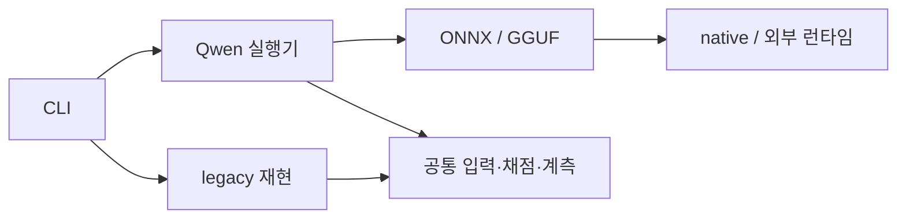

# 코드 구조

현재 작업은 `qwen/`의 Python 실행 경로와 `native/`의 C++ 연결에 모읍니다.

| 위치 | 역할 |
| --- | --- |
| `scripts/edge_asr.py` → `cli.py`, `tools/cli.py` | 공개 명령·선택 구현의 지연 import |
| `qwen/onnx.py`, `qwen/gguf.py` | 모델 로딩·발화 상태·전사·출력 검사 |
| `qwen/benchmark.py` | 모델1회 로딩·첫 추론·워밍업·반복·고정 PCM 재현 |
| `qwen/profiling.py` | ONNX Python/ORT 호출 경계·세션/시계 검증 |
| `native/gguf/`, `native/ort_trace/` | C ABI·ORT 계측과 빌드. [안내](../../native/README.md) |
| `tools/data/` | 데이터 준비·검증·평가 순서 생성 |
| `dataset.py`, `config.py`, `audio_policy.py` | manifest·PCM·해시·설정 검사 |
| `evaluation.py`, `scoring.py`, `metrics.py` | 일반 평가·실패 보존·CER/RTF·재채점 |
| `artifacts.py`, `resources.py`, `runtime.py`, `diagnostics.py` | 원자적 기록·공통 계측·native 경고·런타임 진단 |
| `tools/probes/`, `thermal.py`, `cooling.py` | 열·시간·메모리 제한과 냉각 점검 |
| `streaming.py`, `segmentation.py`, `vad*.py`, `textgrid.py` | 재사용 입력·큐·구간/VAD·주석 기반 |
| `adapters/`, `legacy/` | 공통 factory·이전 비교 모델과 자막/병합 재현 |

어댑터 계약은 `model_files`, `load()`, `transcribe(Audio) -> str`, `close()`입니다. 공통 factory는 선택 모델만 import합니다. GGUF는 ctypes로 별도 C ABI에 같은 float PCM을 전달하며 토큰 스트리밍·청크 간 KV 재사용은 아직 없습니다.

공통 코드와 Qwen은 `legacy`를 import하지 않습니다. CLI dispatch는 예외이며 보고서는 실행 probe에 의존하지 않습니다. `write_json`은 원자적 체크포인트, JSONL 이벤트는 행별 보존입니다. 입력·출력/실패·`ko_cer_v1` 계약을 유지하며 Host 모의 검사와 RP5 실제 추론을 구분합니다. [테스트](../../tests/README.md), [경로 이행](structure_migration.md).
