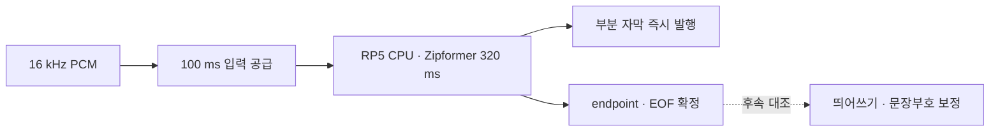

# Raspberry Pi 5 한국어 실시간 ASR 모델 비교

2026-11-27 · Raspberry Pi 5 8GB · Hailo-8L · 100 ms 입력 공급

**Zipformer 174M INT8 320 ms·2스레드**를 RP5 한국어 실시간 자막의 주 후보로 선정했다. 같은 날 Qwen T·P8과 비교한 17개 원음에서 최신 갱신 공백 p95가 4.19·5.82초에서 1.30초로 짧아졌다. 서울 자연발화 8개의 CER는 8.17%, 독립 한국어 24개의 CER는 12.58%였다. SenseVoice Small은 고정 100개의 오류가 더 적고 끝→확정이 빨랐다.

30분 28초 지속 시험에서 Zipformer는 18,283청크를 모두 처리했다. CPU는 4코어 대비 18.6%, 최고 온도는 79.3°C였고 열 제한이나 입력 드롭·모델 실패·확정 유실이 없었다.

## 비교 대상과 배포 자산

| 구성 | 파라미터·구조 | RP5 실행과 자산 출처 | 가중치 조건 |
| --- | --- | --- | --- |
| Zipformer 72M | 71.4M. Causal Zipformer2, stateless predictor와 joiner, 한글 음절 2,460개 | sherpa-onnx ARM64 CPU, 640 ms INT8 encoder·decoder·joiner. [게시자 리비전 `db24b58`](https://huggingface.co/kangkyu/icefall-asr-ko-streaming-zipformer-72m/tree/db24b58d22736349eaeb34cc181ad0f3debf9903) | Apache-2.0. 배포 시 라이선스·저작권 고지와 해당 NOTICE 유지. |
| Zipformer 174M | 공개명 174M, 카드상 155.7M. 더 넓고 깊은 causal Zipformer2, 같은 predictor·joiner | sherpa-onnx ARM64 CPU, 640 ms INT8. [게시자 리비전 `f0e73b1`](https://huggingface.co/kangkyu/icefall-asr-ko-streaming-zipformer-174m/tree/f0e73b1653c3ea75898c6d949dd71c690c9121da) | Apache-2.0. 학습 말뭉치 이용 조건은 별도다. |
| Nemotron 3.5 Streaming 0.6B | 0.6B. Cache-aware FastConformer와 RNN-T predictor LSTM·joiner | sherpa-onnx ARM64 CPU. [NVIDIA 원본 `ea30d66`](https://huggingface.co/nvidia/nemotron-3.5-asr-streaming-0.6b/tree/ea30d66debe3740a08b573244286791d423d6b3e) / [k2 다국어 560 ms INT8 배포](https://github.com/k2-fsa/sherpa-onnx/releases/download/asr-models/sherpa-onnx-nemotron-3.5-asr-streaming-0.6b-560ms-int8-2026-06-11.tar.bz2) | OpenMDW-1.1. 상용 이용을 포함한 이용 허용, 배포 시 라이선스와 출처·저작권 고지 유지. [원문](https://openmdw.ai/license/1-1/) |
| SenseVoice Small | 약 234M (배포 ONNX initializer 원소 수). SAN-M 계열 비자기회귀 인코더·CTC. INT8 파일 239,233,841 B | sherpa-onnx ARM64 CPU. 한국어 `ko`, ITN 켬. [FunAudioLLM 원본 `3847d57`](https://huggingface.co/FunAudioLLM/SenseVoiceSmall/tree/3847d57b6bdf2dd8875cb1508d2af43d80a16bf7) / [보유 배포본](https://k2-fsa.github.io/sherpa/onnx/sense-voice/pretrained.html) | FunASR Model License v1.1. 출처·저자·모델명 보존, 제3조의 참고·학습용 문구가 있어 상용 제품 배포 허용 범위 미확정. [원문](https://github.com/modelscope/FunASR/blob/main/MODEL_LICENSE) |
| Whisper Base 다국어 | 74M. Transformer encoder·자기회귀 decoder | CPU는 기존 sherpa-onnx ARM64의 Base INT8 encoder·decoder, 작업 `transcribe`, 언어 `ko`. [OpenAI 변환 원본 `e37978b`](https://huggingface.co/openai/whisper-base/tree/e37978b90ca9030d5170a5c07aadb050351a65bb) / [k2 ONNX 배포](https://github.com/k2-fsa/sherpa-onnx/releases/download/asr-models/sherpa-onnx-whisper-base.tar.bz2) | OpenAI 원본 코드·가중치는 MIT. Hugging Face 모델 카드의 변환 사본 표기는 Apache-2.0. 해당 배포 자산의 고지 보존. [OpenAI](https://github.com/openai/whisper#license) |
| Whisper Base Hailo-8L | 다국어 Base, 5초 encoder HEF와 고정 시퀀스 decoder HEF | [hailo-apps `1df9b45`](https://github.com/hailo-ai/hailo-apps/tree/1df9b45c940c6d82f84716d9502176c192072089/hailo_apps/python/standalone_apps/speech_recognition). HailoRT 4.23.0의 별도 Python 3.13 환경. 공식 예제는 다국어 가중치에도 영어 토큰을 지정하므로 비교에서는 동일 tokenizer의 `<\|ko\|>`로 언어 토큰만 바꿨다. | 예제 코드는 MIT. HEF와 토큰 임베딩 자산 재배포 조건은 코드 라이선스와 별도로 확인이 필요하다. [공식 자산 경로](https://github.com/hailo-ai/hailo-apps/blob/1df9b45c940c6d82f84716d9502176c192072089/hailo_apps/config/resources_config.yaml) |
| Qwen3-ASR-0.6B | 0.6B 계열. 음성 encoder, LLM Prefill·자기회귀 Decode | Q8·Q4_K_M GGUF와 기존 llama.cpp bridge. Q8 Hailo T·P8·P8+KleidiAI는 같은 CNN HEF. [Qwen 원본 `5eb1441`](https://huggingface.co/Qwen/Qwen3-ASR-0.6B/tree/5eb144179a02acc5e5ba31e748d22b0cf3e303b0) / [ggml Q8 `928ab95`](https://huggingface.co/ggml-org/Qwen3-ASR-0.6B-GGUF/tree/928ab958557df9aa2ef1c93e0e83c7ad0933fae2) | Apache-2.0. 재배포 시 원본·변환본 고지와 적용되는 라이선스를 함께 제공. |

Zipformer 72M 게시자는 KsponSpeech 약 1,000시간을, 174M 게시자는 KsponSpeech 964시간과 AIHub 혼합 약 5,500시간을 보고했다. 두 카드의 640 ms 결과는 KsponSpeech clean/other 합계 6,000개, beam 8, 문장부호 제거 기준으로 각각 8.39%·7.815%다. 이번 RP5는 greedy이며 배포 그래프의 `decode_chunk_len=64` Mel 프레임을 640 ms마다 전진하고 매 단계 77×80 특징을 사용한다. 서울말뭉치가 174M의 AIHub 혼합에 포함됐는지, 게시자가 공개한 KsponSpeech 학습·평가 split을 원본 파일 수준까지 분리했는지는 확인할 수 없었다. KsponSpeech 자체는 프로젝트 독립 평가에서 제외했다. [72M 카드](https://huggingface.co/kangkyu/icefall-asr-ko-streaming-zipformer-72m) · [174M 카드](https://huggingface.co/kangkyu/icefall-asr-ko-streaming-zipformer-174m) · [말뭉치 원 논문](https://doi.org/10.3390/APP10196936)

Nemotron 배포 그래프는 128 Mel, 65프레임 창·56프레임 전진, subsampling 8이며 prompt dictionary의 `ko`와 `ko-KR`은 모두 14다. 생성 스트림마다 음성 공급 전에 `set_option("language", "ko")`를 적용했다. 80/160/560/1120 ms의 별도 k2 배포본 중 560 ms를 사용했다. NVIDIA 공개 모델의 320 ms 옵션과 프로젝트에서 고른 ONNX 자산은 구분한다. sherpa-onnx/core 2.0.1 및 내장 ORT 1.28.2에서 실행 경로를 확보했으므로 공식 NeMo-Speech.cpp는 별도 런타임으로 계측하지 않았다. [k2 다국어 문서](https://github.com/k2-fsa/sherpa/blob/master/docs/source/onnx/nemo/nemotron-streaming.rst) · [NVIDIA 실행기](https://github.com/NVIDIA/NeMo-Speech.cpp)

## 공통 판정 범위

- Raspberry Pi 5 8GB, 기존 냉각·governor·열 보호, 1.5 GHz 상한. 신규 CPU 후보와 Qwen CPU Q8/Q4는 모델 설정 2스레드이며 Qwen Hailo T/P8/KleidiAI는 역사적 프로필의 2/4스레드를 재현했다. CPU 점유는 4코어 총량 대비이며 세션별 ORT 보조 스레드가 있을 수 있다.
- 16 kHz 모노 원본 PCM을 100 ms 단위로 1배속 공급했다. 파일 사이에 2초의 공통 영점 PCM을 넣어 자연 끝점·무음 응답을 관찰했다. 실제 원음 시작/끝은 삽입 무음과 따로 기록했다. 30분 부하에는 기존 연결 원음의 간격을 유지했다. 해시가 같은 음성·순서·정답을 사용했다.
- Zipformer/Nemotron은 한 모델 스트림에 원음 PCM을 순서대로 공급하고 모델 endpoint에서 predictor를 새 발화로 넘긴다. 유효 문장이 있는지와 무관하게 동일한 1.2초 trailing-blank 규칙을 쓰고, 길이 강제 종료 규칙을 끈다. Zipformer는 기본 reset의 Encoder 상태를 유지한다. Nemotron은 런타임 고유 endpoint에서 Encoder와 LSTM 상태를 초기화하며 발화 안에서는 둘 다 이어 간다. EOF에는 모델별 tail padding으로 남은 청크를 처리한다. 이벤트의 `end_frame`은 엔진에 전달한 프레임 위치다. [Nemotron의 endpoint 구현](https://github.com/k2-fsa/sherpa-onnx/blob/v2.0.1/sherpa-onnx/csrc/online-recognizer-transducer-nemo-impl.h#L213)
- SenseVoice/Whisper는 Silero VAD 입력의 RMS 보정·낮은 시작 임계치 0.3을 사용하고 ASR에는 원음을 보낸다. 같은 직렬 작업자와 최신 부분 요청 우선 정책을 쓰며 SenseVoice는 최대 6초, Whisper CPU는 최대 3초 창을 사용한다. 엔진에 새 요청을 넣을 때는 현재 제한된 접두 PCM을 전사한다. 완전 영점으로 판정된 소유 구간은 공통 실행기의 `skipped_silence` 이벤트를 남긴다. Whisper Hailo의 공식 전처리 mel을 사용했으며 비교에서 ASR PCM peak gain을 적용하지 않았다.
- 특징 추출은 sherpa-onnx의 Zipformer 80 Mel, Nemotron 모델 메타데이터의 128 Mel을 사용했다. SenseVoice는 80 Mel에 Hamming 창과 7프레임 LFR·6프레임 전진, 560차원 CMVN을 적용한다. SenseVoice의 메타데이터 `normalize_samples=0`은 특징 추출기에 들어갈 때 모든 표본에 32768을 곱하는 고정 스케일이다. [Nemotron 특징 설정](https://github.com/k2-fsa/sherpa-onnx/blob/v2.0.1/sherpa-onnx/csrc/online-recognizer-transducer-nemo-impl.h) · [SenseVoice 특징 설정](https://github.com/k2-fsa/sherpa-onnx/blob/v2.0.1/sherpa-onnx/csrc/offline-recognizer-sense-voice-impl.h) · [sherpa 표본 스케일](https://github.com/k2-fsa/sherpa-onnx/blob/v2.0.1/sherpa-onnx/csrc/features.cc)
- 시작 온도 센서가 70.5°C 이하일 때 각 실행을 시작했다. 모델 해시·로드·첫 호출로 이후 첫 입력 시점이 달라지므로 시작 표본과 실제 입력 구간 온도를 구분한다. `thermal-run` 운영 모드에서 저전압·결측·시간 초과는 실패로 기록했다. 온도 임계 샘플 수와 실제 CPU 감속, 보드의 과거 제한 플래그는 별개다.
- `ko_cer_v1`은 NFC와 공백·문장부호 제거를 통일한다. 완성 전사는 원본 표기를 보존했다. 배치 RTF 분모는 실제 성공 PCM 길이, 분자는 입력 대기 없는 어댑터 호출 시간이다. 1배속 계산 비율은 Transducer의 native decode step 합 또는 구간형 모델의 부분·확정 호출 합을 전체 입력 시간으로 나눴다. 모델 로드·웜업·큐 대기는 포함하지 않는다.
- 첫 표시 및 갱신 공백은 서버 발행 기준이다. 기존 본문 접두부를 다시 출력하거나 구두점만 바뀐 표시를 새 음성 갱신에서 제외한다. 공통 파일 끝→마지막 겹치는 확정은 부호가 있으며 파일에 끝 무음이 길면 음수가 나올 수 있다. 원음별로 유일하게 귀속되는 첫 표시의 표본 수를 지연과 함께 표시한다. 서울말뭉치 분석에는 해시 검증한 `pWord.ortho.`의 실제 단어 시작·끝만 사용한다. 매칭 가능한 고유 두 어절을 모두 표시한 첫 이벤트를 사용하고, 모델 간 비교에는 같은 단어 매칭 집합을 함께 제시한다.

## RP5 배포 확인과 고정 PCM 진단

신규 CPU 후보 5종은 같은 ARM64 가상환경에서 모델 로드·한국어 3개 전사·1배속 청크 갱신·EOF 배출을 완료했다. 1배속 예비 실행은 모두 입력 드롭과 모델 실패가 0건이었다. 첫 호출은 첫 원음의 앞 2.5초를 사용했다. 배치 초기 시도 세 건은 가드가 찾는 결과 디렉터리 이름이 달라 주소 공간 확인이 기록되지 않았다. 세 자식은 각각 음성 3개 전사를 마쳤다. 표의 본 배치는 가드가 실제 프로세스의 제한을 확인한 새 실행이다.

| 신규 CPU 설정 | 리플레이 준비 (초) | 첫 추론 (초) | 예비 1배속 최대 RSS (MiB) |
| --- | ---: | ---: | ---: |
| Zipformer 72M | 6.58 | 0.33 | 198 |
| Zipformer 174M | 8.89 | 0.44 | 294 |
| Nemotron 560 ms | 3.91 | 1.37 | 1287 |
| SenseVoice Small | 2.53 | 0.24 | 588 |
| Whisper Base CPU | 1.41 | 1.09 | 453 |

Whisper Hailo-8L은 별도 환경의 3개 고정 PCM 실행과 17개 1배속 실행에 성공했다. 17개 실행의 모델 준비는 16.02초, 첫 2.5초 원음 호출은 2.03초였다. 공식 encoder와 decoder HEF가 모두 실제 RP5의 HailoRT에서 로드됐다.

진단 입력은 정답 없는 기존 1·3·5초 PCM 세 개와 정답이 있는 대표 7개다. CER 분모는 155자다. 모든 구성 10/10 호출이 성공했다. T와 P8은 실시간 분할·표시 정책의 이름이므로 배치에서는 같은 CNN 경로를 한 행으로 표시했다.

| 구성 | 1 / 3 / 5초 처리 시간 (초) | 10개 RTF | CER | 최대 RSS (MiB) |
| --- | ---: | ---: | ---: | ---: |
| Zipformer 72M | 0.191 / 0.378 / 0.571 | 0.117 | 18.71% | 187 |
| Zipformer 174M | 0.256 / 0.510 / 0.760 | 0.159 | 5.81% | 287 |
| Nemotron 560 ms | 0.544 / 1.634 / 2.723 | 0.532 | 5.81% | 1276 |
| SenseVoice Small | 0.119 / 0.274 / 0.440 | 0.094 | 5.16% | 439 |
| Whisper Base CPU | 0.678 / 1.399 / 1.877 | 0.475 | 9.68% | 456 |
| Qwen Q8 CPU | 1.479 / 2.996 / 4.671 | 0.941 | 3.23% | 1711 |
| Qwen Q4_K_M CPU | 1.585 / 3.112 / 4.813 | 0.948 | 3.87% | 1211 |

| 가속 기준선 | 1 / 3 / 5초 처리 시간 (초) | 10개 RTF | CER | 최대 RSS (MiB) |
| --- | ---: | ---: | ---: | ---: |
| Qwen Q8 Hailo CNN | 0.814 / 1.631 / 2.594 | 0.557 | 6.45% | 1584 |
| Qwen Q8 Hailo CNN + KleidiAI | 0.709 / 1.458 / 2.327 | 0.506 | 5.81% | 1565 |
| Whisper Base Hailo-8L | 0.709 / 1.739 / 3.064 | 0.584 | 32.26% | 591 |

Zipformer 174M은 Nemotron과 이 입력에서 같은 문자 오류 수였고 5초 PCM의 반환은 1.96초 빨랐다. SenseVoice는 배치 호출 비용이 가장 낮았다. 첫 본문과 단어 표시 지연의 순위는 1배속 실행으로 판단한다.

## 고정 PCM의 연산 단계

5초 진단 PCM에서 별도 ORT 계측으로 encoder·predictor·joiner의 C API `Session.Run`을 측정했다. 연산자 trace를 같이 수집하여 계측 오버헤드가 포함된다. 위 비계측 배치의 처리 시간이나 1배속 자막 지연과 절대값을 직접 대조할 수 없다.

| 모델 | Encoder/전체 그래프 (호출 수·초) | Predictor 또는 Decoder (호출 수·초) | Joiner (호출 수·초) | 전체 호출 (초) |
| --- | --- | --- | --- | ---: |
| Zipformer 72M 640 ms | 9 · 1.406 | 35 · 0.015 | 144 · 0.025 | 1.499 |
| Zipformer 174M 640 ms | 9 · 1.763 | 34 · 0.015 | 144 · 0.024 | 1.864 |
| Nemotron 560 ms | 10 · 3.221 | 27 · 0.037 | 96 · 0.134 | 3.452 |
| SenseVoice Small | 1 · 0.494 (단일 그래프) | — | — | 0.521 |
| Whisper Base CPU | 1 · 0.659 | 16 · 1.461 | — | 2.371 |

Zipformer 174M과 Nemotron은 전체 호출 중 encoder가 각각 약 95%, 93%였다. 174M에서 predictor·joiner를 합한 시간은 0.039초였다. 우선 검토할 이식 경계는 encoder 안에 있다. Whisper Base는 반복 decoder 세션 비용이 컸다.

같은 계측 실행의 encoder 커널 trace를 노드명으로 묶었다. 표는 고정 PCM 여러 호출에서 분류에 성공한 커널 시간의 합이다. 최적화 뒤 이름에 기능이 남지 않은 노드는 기타로 포함했다. 특히 Zipformer의 Attention 열은 이름으로 확인한 커널만 집계하므로 전체 Attention 비용의 하한이다.

| 그래프 | Subsampling (초) | FFN | Attention | Convolution | 기타 |
| --- | ---: | ---: | ---: | ---: | ---: |
| Zipformer 72M 640 ms encoder | 0.092 | 0.467 | 0.019 | 0.267 | 1.782 |
| Zipformer 174M 640 ms encoder | 0.094 | 0.697 | 0.024 | 0.297 | 2.182 |
| Nemotron 560 ms encoder | 0.318 | 1.325 | 2.616 | 1.173 | 0.588 |
| SenseVoice 통합 그래프 | 0.003 | 0.410 | 0.496 | 0.040 | 0.149 |

동일 5초 PCM의 Qwen GGUF 내장 계측에서 Q8 CPU의 음성 encoder·audio prefill·decode는 2.166·1.039·1.285초였다. Hailo CNN의 같은 세 단계는 0.577·0.589·1.279초였고 KleidiAI를 켠 구성은 0.574·0.393·1.228초였다. CPU와 Hailo 대조에는 음성/Prefill 스레드 2→4 변경도 포함된다. Q4 CPU는 decode가 0.937초로 줄고 audio prefill이 1.488초로 늘었다.

## 17개 원음의 RP5 1배속 비교

| 구성 | CER | 치환/삽입/누락 | 첫 본문 p50/p95 (개수) | 첫 4자 p95 | 갱신 p50/p95/최대 | 끝→확정 p95 | 주석 단어 p95 (개수) | 드롭/실패/유실 |
| --- | ---: | ---: | ---: | ---: | ---: | ---: | ---: | ---: |
| Zipformer 72M | 11.98% | 88/8/22 | 1.31 / 2.48 (17) | 2.86 | 0.60 / 2.60 / 5.80 | 2.00 | 0.98 (137) | 0/0/0 |
| Zipformer 174M | 6.19% | 42/6/13 | 1.56 / 2.50 (17) | 2.88 | 0.60 / 2.60 / 5.80 | 2.17 | 1.16 (155) | 0/0/0 |
| Zipformer 174M 320 ms | 6.90% | 47/6/15 | 1.51 / 2.19 (17) | 2.49 | 0.30 / 1.30 / 5.80 | 1.74 | 0.90 (151) | 0/0/0 |
| Nemotron 560 ms | 7.92% | 49/8/21 | 1.75 / 2.19 (17) | 2.75 | 0.60 / 2.31 / 6.20 | 2.46 | 1.05 (144) | 0/0/0 |
| SenseVoice Small | 7.82% | 35/11/31 | 1.47 / 2.36 (17) | 2.55 | 1.08 / 3.40 / 6.16 | 0.88 | 2.49 (105) | 0/0/0 |
| Whisper Base CPU | 23.05% | 111/24/92 | 2.54 / 6.11 (17) | 6.11 | 2.00 / 4.37 / 6.92 | 2.87 | 3.62 (70) | 0/2/0 |
| Qwen Q8 CPU | 5.99% | 30/14/15 | 3.41 / 4.97 (17) | 9.09 | 2.73 / 6.32 / 6.75 | 6.63 | 8.53 (118) | 0/0/0 |
| Qwen Q4_K_M CPU | 6.70% | 40/10/16 | 3.69 / 5.19 (17) | 9.50 | 2.77 / 6.53 / 6.90 | 6.16 | 8.40 (116) | 0/2/0 |
| Qwen T | 6.09% | 35/12/13 | 1.44 / 2.24 (17) | 3.29 | 1.93 / 4.19 / 4.52 | 3.25 | 4.60 (116) | 0/0/0 |
| Qwen P8 | 4.77% | 31/8/8 | 1.86 / 3.11 (17) | 3.34 | 1.97 / 5.82 / 7.44 | 4.47 | 8.39 (129) | 0/0/0 |
| Qwen P8 + KleidiAI | 5.48% | 34/8/12 | 1.43 / 2.52 (17) | 3.18 | 1.79 / 4.67 / 8.40 | 4.01 | 8.42 (125) | 0/0/0 |
| Whisper Base Hailo-8L | 32.18% | 155/45/117 | 3.77 / 5.95 (17) | 5.95 | 2.44 / 4.38 / 4.96 | 6.25 | 7.76 (69) | 0/0/0 |

| 구성 | 추론 합 (초) | 추론/입력 | CPU 초 | 4코어 점유 % | RSS MiB | 최고 °C | 평균 MHz | 제한 플래그 관측 초 |
| --- | ---: | ---: | ---: | ---: | ---: | ---: | ---: | ---: |
| Zipformer 72M | 24.59 | 0.096 | 92.6 | 9.0 | 213 | 73.80 | 1500 | 0.0 |
| Zipformer 174M | 32.91 | 0.129 | 108.9 | 10.6 | 312 | 74.90 | 1500 | 0.0 |
| Zipformer 174M 320 ms | 52.36 | 0.205 | 181.3 | 17.7 | 312 | 77.10 | 1500 | 0.0 |
| Nemotron 560 ms | 123.93 | 0.485 | 294.8 | 28.8 | 978 | 82.05 | 1500 | 0.0 |
| SenseVoice Small | 60.44 | 0.236 | 157.1 | 15.3 | 616 | 77.10 | 1500 | 0.0 |
| Whisper Base CPU | 142.25 | 0.556 | 318.3 | 31.1 | 489 | 83.70 | 1500 | 19.5 |
| Qwen Q8 CPU | 235.09 | 0.919 | 512.0 | 49.1 | 1750 | 90.30 | 1498 | 219.1 |
| Qwen Q4_K_M CPU | 235.10 | 0.919 | 502.5 | 48.3 | 1250 | 89.20 | 1500 | 216.9 |
| Qwen T | 189.42 | 0.741 | 539.0 | 52.6 | 1653 | 88.65 | 1500 | 196.6 |
| Qwen P8 | 217.28 | 0.850 | 615.6 | 59.9 | 1661 | 90.85 | 1454 | 238.2 |
| Qwen P8 + KleidiAI | 219.72 | 0.859 | 612.0 | 59.6 | 1636 | 90.30 | 1470 | 227.8 |
| Whisper Base Hailo-8L | 237.28 | 0.928 | 46.9 | 4.5 | 648 | 73.80 | 1500 | 0.0 |

Stage 3의 원음은 일반 한국어 15개와 서울 자연발화 2개이며 총 255.695초, 정답 985자다. 15개에는 KSS 단답 2개, 동일 녹음의 원음·−24 dB 비교, 숫자·고유명사가 있는 FLEURS를 포함했다. 서울 두 파일은 주석 정답 길이÷초가 가장 낮고 높은 원음이다. 총 118.33초로 낭독과 다른 연결 발화를 포함한다.

Zipformer 174M 640 ms와 T는 CER 6.19%와 6.09%로 985자에서 한 자 차이였다. 174M의 첫 본문 p95는 T보다 0.27초 늦고 P8보다 0.61초 빨랐다. 최신 갱신 p95는 T 4.19→2.60초, P8 5.82→2.60초다. 공통 주석 단어의 발음 끝→표시 p95는 T와 공통 105개에서 4.49→1.17초, P8과 공통 112개에서 8.09→1.18초였다. CPU 점유는 T 52.6%, P8 59.9%, 174M 10.6%였다. RP5 입력 동안의 최고 온도는 각각 88.65°C, 90.85°C, 74.90°C였다.

SenseVoice는 마지막 확정 p95 0.88초로 즉시 확정이 필요할 때 강했다. 짧은 입력에서 부분 갱신은 빠르지만 큰 창 안의 새 음성까지 따라잡는 데는 같은 주석 단어 기준으로 174M보다 시간이 더 걸렸다. Nemotron은 주석 단어를 빠르게 표시했지만 174M보다 높은 계산 비율과 온도, 더 큰 RSS가 관측됐다. 72M은 CPU·RSS가 낮았지만 정확도 차이와 자연 반복 누락이 있었다. 모델별 장점은 지연 축에 따라 달라졌다.

배치와 1배속 Whisper CPU의 차이는 3초 구간 처리로 누락이 늘어나는 현상과 일부 짧은 끝 조각의 빈 확정에서 확인됐다. Whisper CPU와 Q4 CPU 모두 빈 확정이 2건씩 발생해 공통 실행기가 실패로 기록했다. 예비 비교에서는 SenseVoice의 짧은 끝 구간에 일본어 한 글자, Whisper CPU에 ‘감사합니다’가 발행됐다. 삽입한 2초 영점 안에 PCM 범위가 온전히 들어간 본문 확정은 17개 비교의 모든 구성에서 0건이었다. 예비 실행의 오출력은 실제 원음 끝과 겹친 요청에서 나왔다.

KSS 조용한 대조는 −18.9와 −42.9 dBFS였다. 174M·SenseVoice·T는 둘 모두 정규화 기준 오류 0자였고 72M은 둘 모두 같은 1자 오류였다. 실제 −60.4 dBFS FLEURS 원음에서는 174M과 SenseVoice 7자, T 9자, 72M 16자 오류였다. 감쇠 쌍의 결과와 자연 원음 사례의 오류 차이는 별도로 해석한다. 자연발화의 ‘이렇게 이렇게’ 반복은 174M·SenseVoice·Nemotron·T·P8에서 보존됐고 72M·Whisper CPU에서 그대로 남지 않았다.

FLEURS의 보존료 문장에서 T는 경계 양쪽에 ‘매. 매일’을 출력했다. P8은 ‘매일 보존료’를 보존했고 174M 320 ms는 ‘매일보졸료’로 표시했다. 같은 17개에서 정렬상 삽입으로 확인된 인접 확정 중복은 T 4건·P8 3건·Zipformer 320 ms와 SenseVoice 각 0건이었다. 저음량 전문용어 ‘적외선 분광법ftir’은 Zipformer가 ‘적외선분강법’, SenseVoice가 ‘적외선 봉광 법’, P8이 ‘적외선 공간법’으로 전사했다. 모두 영문 약어가 빠졌다.

CPU 단독 행의 모델 스레드는 2개다. T·P8·P8+KleidiAI는 Hailo CNN, Whisper Hailo-8L은 encoder·decoder 공식 HEF를 사용했다. 각 구성은 같은 PCM·순서·공통 자막 발행 규격을 적용했다. 상태가 남아 있는 Transducer의 청크 비용과 비스트리밍 어댑터의 호출 합을 비교했다. 제한 플래그 관측 시간은 1 Hz 표본의 근사이며 실제 클럭이 내려간 시간과 분리한다.

CER와 첫 본문 p95를 함께 본 Pareto 경계에는 320 ms Zipformer, Nemotron, T, P8, P8+KleidiAI가 있다. 320 ms Zipformer와 Nemotron의 첫 본문 p95는 반올림하면 둘 다 2.19초다. 갱신 p95 축에서는 Zipformer 640 ms와 320 ms, T, P8, P8+KleidiAI가 경계를 이룬다. 끝→확정 축에선 SenseVoice도 경계에 들어온다. 실패가 난 두 구성은 경계 계산에서 제외했다.

640→320 ms 변경은 CER 6.19→6.90%, 갱신 p95 2.60→1.30초, 끝→확정 p95 2.17→1.74초를 만들었다. 174M 320 ms에서 T와 함께 맞힌 102단어의 표시 p95는 4.49→0.90초, P8과 공통인 111단어의 지연은 8.09→0.90초였다. CPU 사용은 640 ms 대비 10.6→17.7%로 늘었으며 T 52.6%와 P8 59.9%보다 낮았다. 17개에서 추가 오류 7자는 속도 이득과 함께 고려했다.

Whisper Hailo-8L의 17개 실행은 실패 없이 완료했다. CPU 점유 4.5%·최고 73.8°C의 장점이 있었으나 CER 32.18%·끝→확정 p95 6.25초였다. Base CPU의 3초 창과 Hailo의 최대 5초 창, 다른 양자화·decoder 방식이 모두 결과에 포함된다.

## 확대 검증과 독립 자료

### 청크와 스레드 선택

3개 한국어 원음에서 1·2·4스레드를 대조했다. 아래는 입력을 기다리는 시간을 뺀 실제 호출 합과 4코어의 프로세스 CPU 시간이다. 두 모델의 CER는 각각 스레드가 바뀌어도 오류 2자로 같았다.

| 모델 | 추론 합 1 / 2 / 4스레드 (초) | CPU 1 / 2 / 4스레드 (초) |
| --- | ---: | ---: |
| Zipformer 174M 640 ms | 3.33 / 2.66 / 2.86 | 3.89 / 8.56 / 16.92 |
| SenseVoice Small | 5.81 / 3.46 / 3.01 | 8.17 / 9.56 / 14.61 |

Zipformer는 2스레드에서 이 입력의 호출이 가장 빨랐다. SenseVoice는 4스레드에서 추론 합 0.45초를 줄이면서 CPU 5.05초를 더 사용했다. 2스레드를 유지했다. 174M 320 ms는 같은 세 원음에서 2스레드 추론 합 4.03초·오류 1자였고 전체 17개에서 갱신 개선을 재검증했다.

### 설정 고정과 자료 분리

17개 시험에서 Zipformer 174M 320 ms와 SenseVoice Small 2스레드를 선별했다. 174M은 640 ms의 낮은 계산비용과 320 ms의 짧은 갱신 간격 중 후자를 선택했다. SenseVoice는 발화 종료 직후 확정과 읽기 쉬운 띄어쓰기를 비교할 후보로 두었다. Nemotron은 RNNT의 빠른 표시를 유지했으나 17개 실측에서 320 ms Zipformer보다 추론/입력 비율이 0.485 대 0.205로 컸고 RSS·발열도 높았다. CPU 추론 비용을 낮출 공식 C++ 엔진은 후속 비교에 남는다. 72M은 174M보다 메모리가 적었지만 파일럿 오류가 많고 확인한 자연 반복이 누락됐다. Qwen T·P8·KleidiAI는 정확도와 자막 정책의 가속 기준선으로 유지했다.

고정 100개·서울 8개·낭독 4개는 개발·회귀 자료다. 설정 고정 뒤 TeamUNIVA의 Common Voice 한국어 시험 세트에서 24개를 추출했다. Mozilla Common Voice Scripted Speech 26.0의 한국어 Test 원음을 16 kHz 모노 PCM16으로 통일한 배포본이다. ITN 정답에 숫자 문자가 든 발화와 나머지 중 4.5초 미만·이상 발화를 ID 해시 순으로 각각 8개 뽑았다. 채점에는 발화된 형태의 TN 정답을 사용했다. 기존 `data/`·`results/`의 WAV 2,397개와 원본 및 16 kHz PCM의 SHA-256 중복은 0건이었다. 배포본이 화자 ID를 제공하지 않아 화자 교차 여부를 확인할 수 없다. NVIDIA는 Common Voice와 FLEURS를 학습·평가에 포함했다고 공개했다. 다른 모델도 음원 단위의 학습 비중복은 확인할 수 없다. [NVIDIA 모델 카드](https://huggingface.co/nvidia/nemotron-3.5-asr-streaming-0.6b#training-and-evaluation-datasets)

원본 Common Voice 기여 음성은 CC0 1.0, TeamUNIVA 저장소는 CC BY 4.0으로 표기돼 있다. 음원과 정답은 프로젝트의 로컬 평가 저장소에 보관했다. [고정 리비전의 출처·라이선스](https://huggingface.co/datasets/TeamUNIVA/ko_asr_benchmarks/raw/987cedce3de1a73ce286789483fa3fb7778e0164/README.md)

후보 설정 고정 영수증 SHA-256은 `7177bfa27f363296ae5d92309a840401f94c87dec4a02de3ac8c2bcc2f5fd284`다. Common Voice Parquet는 `ff79b810e6225bb97b8f159b89e85f6160013a1e20a626fd41cc2e804fdb3b23`, 24개 입력 명세는 `c34353f8c9ab0def2c4b364314b6f10e3065ab7085804ec77294dc3b2ae3d0b2`다.

| 입력 묶음 | 1배속 길이 (초) | 연결 PCM SHA-256 |
| --- | ---: | --- |
| 파일럿 17 | 255.695 | `a52e88a57f3d824322353bc331532c44c446db7052fcc9f0966244956ef0d03c` |
| 고정 100 | 1091.145 | `ae3e36df8da0aaa838427749662c75d4883cb19a9a56ba047e649af746a27e6d` |
| 서울 자연발화 8 | 483.428 | `5bfd8d001384c6843f7736256861755167975ab3d5770733a4195acfc2c7901b` |
| 연속 낭독 4 | 273.229 | `9daef9b12d5dd98bd5b48a479aa85b38cae15cf21b6a3e855d21ea082eab4442` |
| 독립 Common Voice 24 | 168.636 | `5144cc1d0446d636a8bff22bdd6b83e4cb637eb1e3631a1d93da2d2787c9e293` |
| 지속 시험 | 1828.217 | `d609ef845b4d97625162a1e38192bb0a49e43491e41467f24133318cf8078dd0` |

### 1배속 정확도와 표시 지연

| 입력 | 구성 | 오류/정답 · CER | 치환/삽입/누락 | 첫 본문 p50/p95 (개수) | 첫 4자 p95 | 갱신 p50/p95/최대 | 끝→확정 p95 | 드롭/실패/확정 유실 |
| --- | --- | ---: | ---: | ---: | ---: | ---: | ---: | ---: |
| 고정 100 | Zipformer | 377/3848 · 9.80% | 165/9/203 | 1.85/3.36 (100) | 3.79 | 0.30/3.80/8.00 | 1.34 | 0/0/0 |
| 고정 100 | SenseVoice | 353/3848 · 9.17% | 121/47/185 | 1.75/3.44 (100) | 3.54 | 1.08/4.76/8.14 | 0.81 | 0/1/0 |
| 서울 8 | Zipformer | 174/2129 · 8.17% | 83/12/79 | 0.91/3.20 (8) | 3.60 | 0.30/1.00/4.50 | 2.20 | 0/0/0 |
| 서울 8 | SenseVoice | 315/2129 · 14.80% | 112/26/177 | 0.98/1.14 (8) | 3.47 | 1.08/2.10/3.52 | 1.35 | 0/0/0 |
| 낭독 4 | Zipformer | 77/1063 · 7.24% | 38/32/7 | 1.57/2.25 (4) | 2.66 | 0.30/1.00/5.10 | 1.54 | 0/0/0 |
| 낭독 4 | SenseVoice | 96/1063 · 9.03% | 31/51/14 | 1.66/2.37 (4) | 2.37 | 1.08/3.14/5.17 | −0.02 | 0/1/0 |
| 독립 24 | Zipformer | 56/445 · 12.58% | 46/1/9 | 1.75/2.39 (24) | 2.99 | 0.30/3.90/5.40 | 1.57 | 0/0/0 |
| 독립 24 | SenseVoice | 79/445 · 17.75% | 56/9/14 | 1.72/2.30 (24) | 2.95 | 1.08/4.55/6.01 | 0.39 | 0/0/0 |

고정 100의 −45 dBFS 미만 12개는 정답 498자다. Zipformer는 76자(15.26%), SenseVoice는 71자(14.26%) 오류였다. 나머지 88개는 각각 301/3350(8.99%), 283/3350(8.45%)이었다. 원음 집단 간 화자·문장 차이도 포함된다. 음량 자체의 영향을 분리한 사례는 위 KSS 감쇠 대조다.

고정 100에서 발화별 CER p50/p95는 Zipformer 5.66%/37.84%, SenseVoice 5.00%/29.63%다. 100개 모두 첫 본문과 유효한 확정이 있었다. SenseVoice는 6초 분할 뒤 남은 40 ms에서 빈 전사로 모델 실패 1건을 기록했다. 별도 200 ms 완전 영점 구간에는 엔진 호출 없이 `skipped_silence`가 기록됐다. 확정 유실은 명시적으로 무음 생략한 구간을 제외한 소유 구간에서 종료 이벤트가 빠진 경우로 센다. 실패한 확정은 실패 이벤트가 있으므로 실패 열에 반영된다.

고정 100의 전체 갱신 공백 p95는 1차 목표 2초를 넘었다. 파일 사이 무음과 원음 안 침묵에 걸친 시간도 들어간다. 비어 있지 않은 모델 소유 구간으로 제한하면 p95는 Zipformer 1.23초, SenseVoice 1.10초다. 모델별 소유 범위는 달라서 서울의 공통 음향 주석도 대조한다.

서울의 주석 단어 881개 중 표시를 확인한 단어는 Zipformer 583개, SenseVoice 382개였다. 공통 360개의 실제 발음 끝→표시 p50/p95는 0.66/0.89초와 0.86/1.72초였다. 음향 주석 시작→첫 본문 p50/p95는 0.91/3.20초와 0.98/1.14초였다. 표본 8개의 p95는 최대값이다. 공통 단어 사이의 쉼이 0.5초를 넘으면 구간을 나누고 실제 발화 중 공백을 계산했다. 그 p95는 0.75초와 1.12초였다. 연속 발화 구간 안에서 가장 긴 표시 공백은 각각 2.26초와 2.10초였다.

SenseVoice의 고정 상한·쉼 분할 경계가 단어 내부를 가른 주석 단어는 18개였다. 고정 상한을 두지 않은 Zipformer는 이 유형의 경계가 0개였다. Zipformer의 확정이 원음 경계에 걸친 두 원음은 원음별 CER 분포에서 제외하고 전체 연결 채점에는 포함했다. 확인한 ‘되게 되게’ 반복은 둘 다 보존했다.

낭독 4개는 기존 Zeroth 음성을 같은 화자끼리 이어 붙인 개발 자료다. 여성 무간격 원음에서 두 모델 모두 정답에 없는 ‘말씀하셔 가지고’와 이어지는 말의 일부를 전사했고 각각 정답 206자 중 오류 50자를 기록했다. 원본 전사에 빠진 음성 가능성이 있어 이 사례는 정답 밖 삽입으로 기록했다. SenseVoice는 200 ms 꼬리에서 빈 확정 1건을 기록했다. 파일 끝→확정 p95 −0.02초는 파일의 끝 무음 안에서 최종 자막이 이미 발행됐다는 뜻이다.

| 독립 자료 유형 | 정답 문자 | Zipformer 오류 / CER | SenseVoice 오류 / CER |
| --- | ---: | ---: | ---: |
| 짧은 발화 8개 | 85 | 12 / 14.12% | 11 / 12.94% |
| 긴 발화 8개 | 174 | 16 / 9.20% | 23 / 13.22% |
| 숫자 포함 8개 | 186 | 28 / 15.05% | 45 / 24.19% |

독립 자료의 짧은 발화에서 빈 전사는 두 모델 모두 0건이다. Zipformer는 ‘여러분’을 ‘유럽은’으로 바꿨고 SenseVoice는 그대로 표시했다. 숫자 문장 ‘첫 번에 삼십전, 둘째 번에 오십전’에서 Zipformer는 두 수량을 유지했고 SenseVoice는 ‘30 전’과 ‘50점’을 냈다. 독립 자료에는 TN 정답을 사용했으며 `ko_cer_v1`에서 ‘삼십’과 ‘30’은 문자 단위로 다른 표기다. 숫자 글자체 차이와 ‘오십전→50점’ 같은 단위 오류가 모두 CER에 반영된다.

1차 목표 중 Zipformer는 독립 세트에서 첫 본문 p95 3초·끝→확정 2초·추론/입력 0.7·드롭/실패 0건을 만족했다. CER 12%, 첫 본문 p50 1.5초, 전체 갱신 공백 p95 2초는 넘었다. 단어 시각 주석이 있는 서울에서 공통 단어 끝→표시 p95 0.89초와 전체 갱신 p95 1.00초는 최종 개발 목표 안이었다. 전체 고정 100·독립 자료의 첫 표시와 긴 무음 후 갱신에는 개선 여지가 있다.

### 자원과 부분 자막

| 입력 | 구성 | 계산/입력 · 추론 합 (초) | CPU 초 / 4코어 % | RSS MiB | 최고 °C | 평균 MHz | 열 제한 관측 초 |
| --- | --- | ---: | ---: | ---: | ---: | ---: | ---: |
| 고정 100 | Zipformer | 0.203 · 221.5 | 757.8 / 17.4 | 383 | 78.20 | 1500 | 0.0 |
| 고정 100 | SenseVoice | 0.219 · 239.5 | 627.5 / 14.4 | 586 | 79.30 | 1500 | 0.0 |
| 서울 8 | Zipformer | 0.205 · 99.0 | 349.9 / 18.1 | 329 | 79.30 | 1500 | 0.0 |
| 서울 8 | SenseVoice | 0.259 · 125.2 | 320.8 / 16.6 | 636 | 79.30 | 1500 | 0.0 |
| 낭독 4 | Zipformer | 0.205 · 55.9 | 194.8 / 17.8 | 315 | 77.65 | 1500 | 0.0 |
| 낭독 4 | SenseVoice | 0.257 · 70.2 | 178.9 / 16.3 | 621 | 78.75 | 1500 | 0.0 |
| 독립 24 | Zipformer | 0.203 · 34.2 | 115.6 / 17.1 | 301 | 76.55 | 1500 | 0.0 |
| 독립 24 | SenseVoice | 0.154 · 26.0 | 73.8 / 10.9 | 604 | 76.55 | 1500 | 0.0 |

고정 100에서 Zipformer는 native decode 3,411회, 청크당 p50/p95 64.74/66.76 ms였다. 두 모델의 입력 큐 최대는 100 ms 청크 1개였고 입력 끝과 종료에서 0개였다. 이 기간의 10 Hz 최신 표시 입력 지연 p95는 4.50초·4.92초였다.

고정 100에서는 Zipformer가 표시한 정규화 본문을 철회하거나 바꾼 경우가 없었다. SenseVoice는 표시 본문을 250회 수정하고 뒤쪽 1,580자를 철회했다. 마지막 부분과 확정이 모두 나온 154구간 중 105구간은 마지막 부분 전체가 확정의 접두부였다. Zipformer는 100구간 모두에서 이를 유지했다. 문자 오류를 정렬한 뒤 공백 위치를 대조하면 기준 1,165개 중 Zipformer 0개, SenseVoice 1,094개가 맞았다. SenseVoice가 출력한 전체 공백은 1,228개였다.

서울의 부분 표시를 해당 이벤트의 입력 범위 안에서 발음이 끝난 주석과 대조했다. Zipformer 1,094이벤트의 오류는 11,568/125,798자(9.20%), SenseVoice 360이벤트는 981/4,141자(23.69%)였다. 모델마다 소유 범위와 이벤트 수가 다르고 끝 경계에서 발음 중인 단어도 표시할 수 있는 집계다. 장문 표시의 10 Hz 입력 지연 p95는 각각 1.40초, 1.91초였다.

독립 24개의 정답 공백 148개 중 Zipformer는 0개, SenseVoice는 132개를 맞혔다. SenseVoice는 기준 문장부호 20개를 모두 같은 문자 위치에 출력했고 10개를 더 붙였다. Zipformer는 독립 자료에서 문장부호가 0개였다. 원문 표시의 차이는 정규화 CER와 별도로 측정했다.

## 30분 28초 지속 시험

독립 평가 뒤 Zipformer 174M 320 ms·2스레드를 1.5 GHz 상한에서 단독 실행했다. 기존 KSS 연속 낭독 부하와 마지막 12초 영점 뒤 자연 음성을 연결한 1,828.216625초다. 2026-11-24의 저장 P8 실행과 2,925만 PCM 프레임의 해시 및 정답 7,823자가 같다. 낭독을 반복한 공학 부하로 장시간 계산·발열·자막 지속성을 검증했다. 독립 정확도는 위 Common Voice 대조에서 판단한다. [저장 P8 지속 실측](optimization/cpu-stages-20261126.md#30분-지속-부하와-채택-판단)

| 측정 | 11월 24일 저장 Qwen P8 | 11월 27일 Zipformer 174M 320 ms |
| --- | ---: | ---: |
| 전체 오류 / 정답 · CER | 268/7823 · 3.43% | 76/7823 · 0.97% |
| 추론 합 (초) / 입력 대비 | 1344.68 / 0.736 | 376.11 / 0.206 |
| 프로세스 CPU 초 / 4코어 점유 | 3840.7 / 52.4% | 1360.8 / 18.6% |
| 재생 최대 RSS (MiB) | 1790 | 678 |
| 입력 구간 평균 / 최고 온도 (°C) | 88.06 / 91.40 | 76.30 / 79.30 |
| 평균 클럭 (MHz) / 1490 MHz 미만 (초) | 1423 / 280.9 | 1500 / 0.0 |
| 현재 제한 플래그 관측 (초) | 1828.2 | 0.0 |
| 최신 갱신 공백 p50/p95/최대 (초) | 2.67/5.11/12.17 | 0.30/1.00/12.80 |
| 최신 표시 입력 지연 p95 (초) | 5.87 | 0.90 |
| 12초 무음 뒤 첫 본문 (초) | 1.51 | 1.57 |
| 재개 원음의 끝→확정 (초) / 오류 | 3.53 / 1자 | 0.14 / 4자 |
| 처리 청크 / 드롭·실패·유실 | 18,283 / 0·0·0 | 18,283 / 0·0·0 |

두 실행은 날짜·워밍업·재생 시작 온도가 달랐다. 표는 같은 PCM에서 관측한 운영 성능을 비교한다. 제한 플래그 시간과 실제 클럭 하락 시간은 1 Hz 계측의 시간 가중 근사다. 소프트웨어 추론 합에는 입력 대기·모델 준비·종료 뒤 채점이 들어가지 않는다. Zipformer는 5,714번의 native decode에서 청크당 65.66/68.14 ms(p50/p95)를 기록했다. 1배속 종료 뒤 RP5에서 약 2분 42초 동안 문자 오류와 실행 산출물을 집계했다.

Zipformer 입력 큐는 순간 최대 100 ms 청크 2개·최고 대기 0.126초였고 음성 끝과 세션 종료에서 0개였다. native decode는 같은 소비 루프에서 실행하므로 별도 모델 요청 대기가 없다. 저장 P8은 별도의 모델 요청 큐에서 최대 4.66초를 기다렸다. 30분 입력의 마지막 영점 무음에 본문 이벤트는 0개였다. Zipformer 최대 갱신 공백 12.80초는 그 무음을 포함했고 음성 구간 내 최대 공백은 1.60초였다. 첫 여섯 5분 창의 최신 입력 지연 p95는 모두 0.90초였다.

| Zipformer 입력 구간 | 시간 가중 평균 온도 | 평균 클럭 | 구간 표본 최대 RSS |
| --- | ---: | ---: | ---: |
| 0.0~10.2분 | 75.57°C | 1500 MHz | 415 MiB |
| 10.2~20.3분 | 76.75°C | 1500 MHz | 512 MiB |
| 20.3~30.5분 | 76.60°C | 1500 MHz | 652 MiB |

가장 긴 native 확정 구간은 1,810.8초였다. 긴 부분 자막 전체를 매번 기록해 본 시험의 `jobs.jsonl`이 약 50 MiB로 늘었고 RSS 표본도 증가했다. 운영에서는 엔진 상태를 유지한 채 읽기 단위로 표시를 넘기고 최근 갱신만 메모리에 두는 방식의 연속성·메모리를 별도로 검증할 필요가 있다.

## 모델 선정과 운영 아키텍처

SenseVoice보다 서울 자연발화·연속 낭독·독립 시험에서 오류가 적었고, 서울의 공통 단어 표시 p95는 0.83초 짧았다. 고정 100과 독립 시험에서 첫 본문이 늦는 표본, 낮은 음량의 오류, 띄어쓰기와 문장부호는 운영 적용 전에 확인할 과제다.

- SenseVoice Small은 짧은 발화의 빠른 확정과 읽기 쉬운 표기가 중요한 경우의 CPU 대조다. 긴 발화의 6초 경계에서 잘린 단어와 두 차례의 빈 꼬리 확정이 관측됐다. 두 모델을 동시에 사용했을 때의 계산·발열 비용은 별도로 검증해야 한다.
- Qwen P8은 17개에서 CER 4.77%로 가장 낮아 정확도 대조로 유지한다. T는 빠른 Qwen 기준선이다. Zipformer 320 ms의 17개 최신 갱신 p95는 T보다 69%, P8보다 78% 짧았다. Whisper Hailo는 낮은 CPU 점유의 장점이 있었고, 한국어 CER와 확정 지연이 이 용도의 목표 밖이었다. 72M은 RAM이 더 작은 장비의 경량 대조, Nemotron은 공식 C++ 경로 또는 encoder 일부 가속을 검증할 후속 후보다.
- RP5에서 WAV 또는 ALSA 입력을 16 kHz 모노 PCM으로 받아 단일 CPU 추론 작업자가 모델 스트림을 유지한다. 준비 단계에서 로드와 웜업을 마친다. native endpoint와 EOF 확정은 기존 자막 이벤트로 발행한다. 띄어쓰기·구두점 보정은 확정 후 짧은 텍스트 작업으로 검증하고 부분 경로의 지연을 별도로 측정한다. 원문을 함께 보존해 CER와 문장부호 품질을 재검산한다.



우선순위는 정답이 있는 새 저음량 대화에서 첫 본문과 고유명사·반복을 재검증하고, 보정을 붙인 확정의 지연·읽기 품질을 같은 PCM으로 확인하는 것이다. 이후 Hailo를 사용한 구성은 CPU 점유와 발열의 감소를 보고 판단한다.

실험 종료 시 RP5의 ALSA 목록에는 HDMI 장치만 있었고 USB 입력이 연결된 상태의 전사는 미측정이다. 2.4 GHz 지속 대조와 Q4+Hailo는 이번 선택 기준인 1.5 GHz 비교에서 제외했다.

## Hailo-8L 이식 우선순위

호스트는 기존 DFC 3.34.0으로 컴파일하고 RP5는 HailoRT/커널 드라이버 4.23.0, PCIe Gen2 ×1을 사용한다. 아래 상태 크기는 배치 1의 공개 ONNX 논리 텐서 크기다. 상태가 매 스텝 CPU로 왕복한다고 가정한 전송량이며 장치 한쪽에 상태를 상주시킬 수 있는지, 양자화된 전송 버퍼와 실제 PCIe DMA 비용은 별도 검증이 필요하다. [기존 Qwen 분할과 실제 전송 기록](optimization/hailo-partitions-20261123.md)

| 모델 | 이식 분석 |
| --- | --- |
| Zipformer 72M·174M | 6개 encoder stack의 FFN·Attention·Conv에 비용이 집중될 수 있다. FP32 상태에는 층별 K/V 두 갈래, 비선형 Attention 중간 상태, Conv 좌문맥, subsampling 상태·처리 길이가 있다. 배치 1, 640 ms에서 각각 98개·116개 상태 입력이며 한 방향 1,850,888 B·2,625,032 B다. 왕복 최소 논리량은 약 5.78·8.20 MB/s, 호출은 1.56회/초다. 174M 320 ms도 같은 상태 크기이며 왕복 약 16.41 MB/s·초당 3.125회다. 최우선 시험은 상태 텐서가 작은 고정 77×80 subsampling 또는 연속된 고정 FFN 블록이다. 작은 predictor·joiner와 greedy를 CPU에 둔다. 전체 encoder는 동적 Slice/Gather, 정규화, softmax, state 반환과 다중 컨텍스트 비용 때문에 난도가 높다. |
| Nemotron 560 ms | log-Mel 128×65, 채널 cache `[1,24,56,1024]`, depthwise 시간 cache `[1,24,1024,8]`, 길이 1개다. FP32 상태 왕복 12,582,928 B/step, 약 22.47 MB/s, 1.79회/초다. 배포 그래프 encoder에는 ConvInteger 77, MatMulInteger 219, Softmax 24 및 동적 양자화·mask 연산이 있다. 초기 순서는 subsampling 또는 인접 Conformer FFN·depthwise conv 블록을 정적 shape로 재수출해 실측하는 것이다. 동적 prompt, cache 갱신, LSTM predictor·joiner·greedy는 CPU에 남기는 대조부터 시작한다. |
| SenseVoice Small | 고정 창의 560차원 LFR 특징 투영·SAN-M 블록 또는 encoder를 후보로 삼는다. CTC collapse, 태그 필터, ITN·VAD와 텍스트 조립은 CPU에 남길 수 있다. 연속 encoder 상태 왕복은 없으나 길이별 padding, FFN·attention 정규화/마스킹, INT8 calibration의 작은 음량·잡음 조건을 검증해야 한다. |
| Whisper Base | 공식 HEF 두 개가 있어 이식 작업의 우선순위가 낮다. H8L decoder는 토큰 embedding·position Add를 CPU에서 계산하고 매 생성 토큰에 decoder HEF를 호출하며, 기본 예제는 GPU나 KV 캐시를 가정하지 않는 고정 시퀀스 실행이다. 전체 decoder의 고정 shape·반복 호출·logit 전송을 확인해야 한다. |
| Qwen3-ASR | CNN 3층·GELU HEF 재사용은 이미 검증했다. 추가 FFN/Attention 이식은 단일·다중 행/가중치 접근·동적 길이·CPU KV를 고려해야 한다. 현재 단계에서 새 HEF나 양자화 후보는 만들지 않았다. |

ONNX Runtime의 `DynamicQuantizeLinear`·`MatMulInteger`/ `ConvInteger` 조합을 DFC의 INT8 계산 경로로 바로 간주할 수 없다. 작은 고정 파티션의 부동소수점 원본에서 parser와 calibration을 각각 검증하고, 조용한 시작·큰 입력·긴 cache 상태를 포함한 실제 특징 분포로 양자화 오차를 확인한다. Hailo 내부 컨텍스트 분할 수, 장치 호출·동기화, 경계 layout과 자료형 변환을 각각 재고 실시간 CPU 점유·온도 절감으로 판단한다. [Hailo DFC 지원 연산](https://community.hailo.ai/t/supported-operators/5046) · [기존 컴파일·대조](optimization/hailo-partitions-20261123.md)

174M 320 ms 그래프의 배치 1 입력은 `[1,45,80]`이다. 첫 블록의 예는 key `[128,1,128]`, nonlinear attention `[1,1,128,144]`, value 각각 `[128,1,48]`, convolution의 좌문맥 각각 `[1,192,15]`이며 블록별 채널 수는 달라진다. 이 encoder에는 `MatMulInteger` 344개와 `DynamicQuantizeLinear` 312개가 있다. SenseVoice는 `[1,T,560]`과 길이·언어·ITN 입력을 받아 `[1,T,25055]` logits를 낸다. 최종 argmax/CTC collapse를 CPU에 둘 경우 전체 FP32 logits 경계의 전송량도 따로 확인해야 한다.

## 가중치 및 입력 출처 검증

다음 해시는 설치된 실제 가중치와 토큰 자산의 SHA-256이다. 로컬 런타임의 설정과 빌드 명세는 각 실행의 `worker.json` 및 배치 `manifest.json`에 기록했다. 새 배포본 중 Nemotron ONNX 아카이브와 SenseVoice 배포 아카이브는 GitHub에 게시된 SHA-256도 대조했다.

```text
f5dfa6c8609b29da86c739d4904889475c33b62e28e70c619952a0ee6c31416f  zipformer-174m/decoder-epoch-99-avg-1-chunk-32-left-128.int8.onnx
d07cbf5198c8c6d41108cc9c9e057b0a3591846867b6a4d2e283add3bbb84413  zipformer-174m/encoder-epoch-99-avg-1-chunk-32-left-128.int8.onnx
64efd9aeb71fb2278c713b3d5eb5ec45edf6b2ccd8716d3709044f17723c13fd  zipformer-174m/joiner-epoch-99-avg-1-chunk-32-left-128.int8.onnx
40c3c57ad27b45b59e27bec8bfc02f04d27c060aeb8e964ae2f87bd9f356bf7d  zipformer-72m/decoder-epoch-99-avg-1-chunk-32-left-128.int8.onnx
0f6c2786d44785bb4bff29452ef28b4360ce18451fd52355eb706ddc9302b88b  zipformer-72m/encoder-epoch-99-avg-1-chunk-32-left-128.int8.onnx
7d3bd9c1e9cf60efa5d5fed728fbd52d0f08139775f9e9002fd088b4d78f3e73  zipformer-72m/joiner-epoch-99-avg-1-chunk-32-left-128.int8.onnx
435dfb9e0a2b6a79124f1a4d8f0f33a951b25384726e2e0d854f081533e6ec9d  zipformer-174m/tokens.txt
435dfb9e0a2b6a79124f1a4d8f0f33a951b25384726e2e0d854f081533e6ec9d  zipformer-72m/tokens.txt
19f9c98fc6d0a2c33a65a43b36fdb2e914c26c0aa9764be3aebc502a1e982fb0  sherpa-onnx-nemotron-3.5-asr-streaming-0.6b-560ms-int8-2026-06-11/decoder.int8.onnx
012e9321373af99021415e0b0eb3ec827b4be3153be6f30d9b448fe65e896e68  sherpa-onnx-nemotron-3.5-asr-streaming-0.6b-560ms-int8-2026-06-11/encoder.int8.onnx
4101c7c679a0bc30483794b27a059e34e79232aa2068d78d51231a22c8b0d7ce  sherpa-onnx-nemotron-3.5-asr-streaming-0.6b-560ms-int8-2026-06-11/joiner.int8.onnx
729cc103155bafa785f9cd45746cd41cabe97eab7182fc04d594129587958f8a  sherpa-onnx-nemotron-3.5-asr-streaming-0.6b-560ms-int8-2026-06-11/tokens.txt
9759d217388a01b3a4c7c15533201067b48ae819c4daafc8624e64b9409dc02d  sherpa-onnx-whisper-base/base-decoder.int8.onnx
0b8fb1304b6109976038efff5ace81720e00386f3ff6b54ee8c75291ca0a1e11  sherpa-onnx-whisper-base/base-encoder.int8.onnx
b34b360dbb493e781e479794586d661700670d65564001f23024971d1f2fa126  sherpa-onnx-whisper-base/base-tokens.txt
117c7627afaa1ec653c3c670ca893c0153a79010d3a7add64c412b3e5f312f57  whisper-hailo8l/base-whisper-decoder-fixed-sequence-matmul-split_h8l.hef
f58929ef9ba61cd443d2707c6a0effe65ad7eb035b56a85ae611c0084c6aac6b  whisper-hailo8l/base-whisper-encoder-5s_h8l.hef
e39b7d22435d08891c3c77b3e2cb32474917c3a1215ad83200a0b8019bb9452d  whisper-hailo8l/onnx_add_input_base.npy
9e83abd1faf2b66a8931dd58ff7b8207d301395f5486d6c069d6cd415e1ba3e6  whisper-hailo8l/token_embedding_weight_base.npy
27fc476bfe7f17299480be2273fc0608e4d5a99aba2ab5dec5374b4482d1a566  whisper-hailo8l/tokenizer/tokenizer.json
7450ae70723a5ef9d341e3cee628c7cb0177f36ce42c44b7ed2bf3325f0f6d4c  hailo-whisper/assets/mel_filters.npz
c71f0ce00bec95b07744e116345e33d8cbbe08cef896382cf907bf4b51a2cd51  models/sherpa-onnx-sense-voice-zh-en-ja-ko-yue-int8-2024-07-17/model.int8.onnx
f449eb28dc567533d7fa59be34e2abca8784f771850c78a47fb731a31429a1dc  models/sherpa-onnx-sense-voice-zh-en-ja-ko-yue-int8-2024-07-17/tokens.txt
bca259818b50ca7c4c05e9bdb35a5dc04fa039653a6d6f3f0f331f96f6aa1971  models/qwen3-opt/gguf-q8-20261109-01/Qwen3-ASR-0.6B-Q8_0.gguf
41a342b5e4c514e968cb756de6cd1b7be39eff43c44c57a2ef5fc6522e36603d  models/qwen3-opt/gguf-q8-20261109-01/mmproj-Qwen3-ASR-0.6B-Q8_0.gguf
3f711631ac7b81f223e08471838f8129b9716e4fe9935ebf99c58e320fc18633  models/qwen3-opt/gguf-quant-20261110-01/derived/Qwen3-ASR-0.6B-Q4_K_M.gguf
9e2449e1087496d8d4caba907f23e0bd3f78d91fa552479bb9c23ac09cbb1fd6  models/silero-vad-k2-20261029/silero_vad.onnx
f5dfa6c8609b29da86c739d4904889475c33b62e28e70c619952a0ee6c31416f  zipformer-174m-320ms/decoder-epoch-99-avg-1-chunk-16-left-128.int8.onnx
e595e2e37f46078387868ffa656b775de787fa511cf851cf8e1892d7dbdabe54  zipformer-174m-320ms/encoder-epoch-99-avg-1-chunk-16-left-128.int8.onnx
64efd9aeb71fb2278c713b3d5eb5ec45edf6b2ccd8716d3709044f17723c13fd  zipformer-174m-320ms/joiner-epoch-99-avg-1-chunk-16-left-128.int8.onnx
435dfb9e0a2b6a79124f1a4d8f0f33a951b25384726e2e0d854f081533e6ec9d  zipformer-174m-320ms/tokens.txt
```

- Nemotron ONNX 아카이브 SHA-256 `c6bf5e0df765f9d5b43bc9e0536d4b4b3e7d40bdf5ecf13e45f134c51c05ae3a`.
- SenseVoice INT8 배포 아카이브 SHA-256 `7d1efa2138a65b0b488df37f8b89e3d91a60676e416f515b952358d83dfd347e`.
- Whisper Base CPU ONNX 아카이브 SHA-256 `911b2083efd7c0dca2ac3b358b75222660dc09fb716d64fbfc417ba6c99ff3de`.
- Qwen Q8 T·P8의 CNN HEF SHA-256 `2eaa3e44f082b6b91465cc2a3c1cdea8bc3c18b309ca508d223b7d0312b04235`. Q4_K_M의 원본 BF16 GGUF SHA-256 `12b2894d9a7c98cd8f26670f5a47ab738f42bcc98df21e109be493870c71ba50`. 양자화 경로와 입력·출력 파일은 로컬 `models/qwen3-opt/gguf-quant-20261110-01/derived/q4_k_m.json`에서 확인할 수 있다.

## 재현 경로

- 신규 모델 설정은 [configs/model_comparison/](../../configs/model_comparison/)에 있다. Zipformer는 위 리비전의 `tokens.txt`와 encoder·decoder·joiner의 `epoch-99-avg-1-chunk-32-left-128.int8.onnx` 자산을 받는다. 174M 320 ms만 같은 리비전의 `chunk-16-left-128` 파일을 받는다. Nemotron·Whisper CPU는 표의 아카이브를 풀고, SenseVoice는 프로젝트 보유 INT8 자산을 사용한다. 각 TOML의 모델 경로에 배치하고 위 SHA-256과 대조한다.
- Whisper Hailo는 공식 소스의 `hailo_apps/python/standalone_apps/speech_recognition`과 해당 mel filter를 쓴다. `resources_config.yaml`의 Hailo-8L Base encoder/decoder HEF, Base token embedding·position NPY, OpenAI 다국어 tokenizer를 배치한다. Python 3.13 격리 환경에 Torch 2.9.1·Transformers 4.57.6·ORT 1.31.1 및 HailoRT 4.23 Python 바인딩을 사용했다. 공급 명령과 한국어 프롬프트 어댑터는 원시 실행 `inputs/run.py` 및 `inputs/hailo_whisper.py`에 남겼다.
- 피실험 장비에 기존 열 보호를 둔 채 1.5 GHz 상한과 시작 온도를 확인한다. 모든 실행에 새 출력 디렉터리를 지정하고 다른 추론 실행과 겹치지 않게 한다. `manifest`에는 16 kHz PCM·정답·순서가 고정된 JSONL 경로를 지정한다. 30분 명세는 WAV 자체에 연결 간격이 들어 있어 `--gap-s 0`과 가드 `--timeout-s 2100`으로 공급했다. [RP5 동기화와 결과 회수](../../docs/guides/deployment.md)

```bash
.venv/bin/python scripts/edge_asr.py tools thermal-run \
  --output "$run" --timeout-s 1200 --temperature-policy operational -- \
  .venv/bin/python scripts/edge_asr.py tools replay-asr \
  --config configs/model_comparison/zipformer_174m_320ms.toml \
  --manifest "$manifest" --output "$run" --gap-s 2 --warmup-max-s 2.5
```

SenseVoice 대조에는 같은 1배속 명령의 모델 설정을 바꾸고 아래 옵션을 추가한다. Whisper CPU는 같은 명령에서 Whisper Base 설정을 사용하고 창 3초, 목표 경계 2.4초, 초기 부분 1초, 후속 새 음성 1.3초를 사용했다.

```bash
--vad-model models/silero-vad-k2-20261029/silero_vad.onnx \
--vad-preprocess rms26-floor80 --vad-threshold 0.3 --vad-max-speech-s 15 \
--max-segment-s 6 --boundary-target-s 4.5 --split-on-pause --onset-context-s 0.2 \
--partial-mode continuous --partial-after-s 0.8 --partial-min-new-s 0.9
```

RP5의 PCM·청크·발행·부하 기록은 `worker.json`, `stream/producer.jsonl`, `jobs.jsonl`, `thermal.jsonl`에 있다. `tools subtitle-metrics`에 `--seoul-manifest data/evaluation/longform-20261117-01/natural.jsonl`을 넘겨 주석 단어를 비교한다. 완료한 실행의 경계와 문장부호 정렬은 `--boundary-errors --punctuation-reference "$manifest"`를 추가해 검산했다.

## 코드·원시 기록·장비 복원

- 공통 비교 경로는 `1d4296a`, 마지막 입력 프레임 검증은 `23f9b94`, 확대 및 지속 시험의 공통 소스는 `4486b7e`다. Host의 기존 회귀 520개는 4개 건너뜀으로 통과했고 Ruff·M1 해시·6개 비교 설정 검사가 성공했다. 실제 ARM64 추론은 RP5 기록으로 검증했다.
- RP5의 `results/optimization/asr-comparison-20261127-01/`를 개발 PC의 같은 실험 ID 아래 `rp5/`로 회수했다. 원시 파일 816개의 상대 경로별 SHA-256이 모두 일치했다. `board-raw.sha256`의 SHA-256은 `30f253caf03059dba94b0b50582d3395186d1e11ccc54e203a23110fe1a1ee42`다. `replay-audit.txt`는 21개 비교 실행의 PCM·입력 명세·고정 설정·공급 청크 완료를 기록한다.
- RP5 상한은 2,400,000 kHz, governor는 `ondemand`로 복원했다. Hailo PCIe 드라이버 4.23.0과 기존 포트 8765 청취 서버가 동작하는 상태를 확인했다. 복원 검사는 원시 실행의 `board-final-state.txt`에 포함했다.
