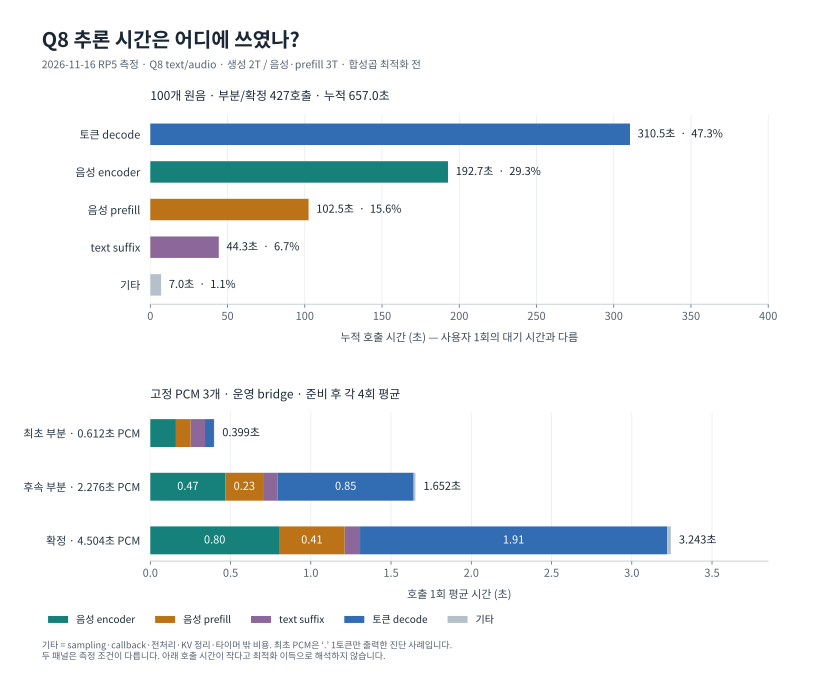
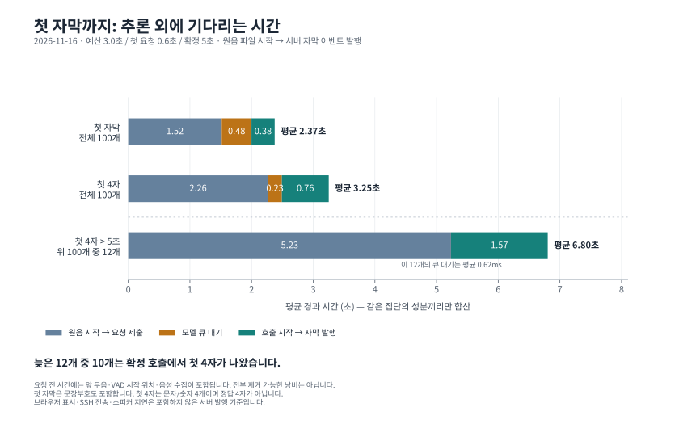
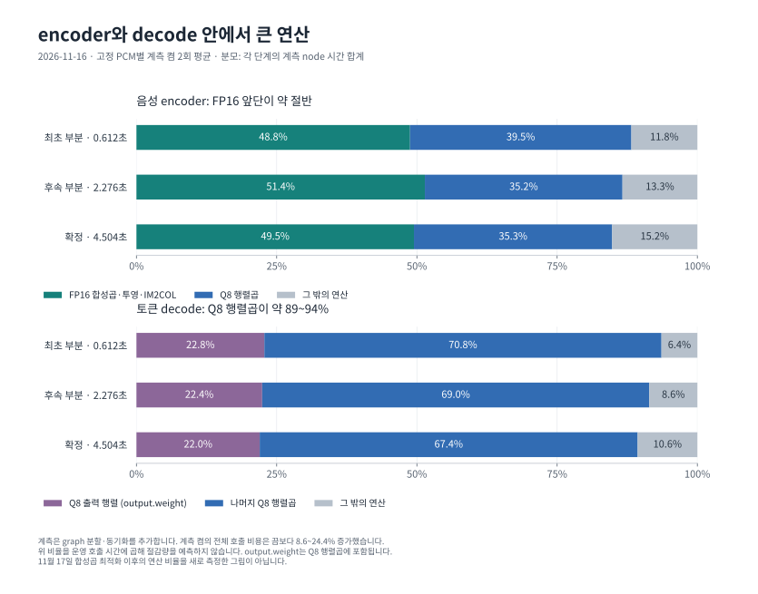

# Q8 프로파일링 시각화

2026-11-17 작성. **11월 16일 RP5 프로파일링 자료**를 그래프 3장으로 정리했습니다. 새 추론·성능 측정은 없으며 기존 모델·설정·측정 결과는 변경하지 않았습니다. 11월 17일 합성곱 최적화 이후의 연산 비율을 재측정한 자료가 아닙니다.

원본은 [Q8 재프로파일링 보고서](reprofile-q8-20261116.md)와 [측정 JSON](reprofile-q8-20261116.json)입니다. 연속 입력은 두 조건 중 `budget300`만 사용했습니다. Q8 text/audio·생성 2T/음성·prefill 3T·첫 요청 0.6초·부분 예산 3초·확정 5초·고정 text prefix KV 조건입니다.

## 1. 추론 시간: decode와 encoder가 크다

위 그래프는 100개 원음을 1배속 입력한 **부분/확정 427호출의 누적 비용**입니다. decode 47.3%·encoder 29.3%·음성 prefill 15.6% 순입니다. 누적 657.0초는 한 사용자가 기다린 시간이 아닙니다. 앞 고정 text prefix는 427회 모두 캐시 적중으로 평가 시간이 0초입니다.

아래는 연속 실행에서 뽑은 고정 PCM 3개를 운영 bridge로 각각 준비 후 4회 측정한 평균입니다. 전체 호출은 최초 0.399초·후속 1.652초·확정 3.243초입니다. 최초 PCM은 `.` 1토큰만 반환한 진단 사례이므로 정상 한국어 문장의 대표 속도로 보지 않습니다. 위 연속 실행과 시작 온도·순서·callback 조건이 달라 직접적인 성능 개선 비교도 아닙니다.

## 2. 자막 대기: 요청 전 시간과 추론을 구분한다

같은 이벤트들의 **평균**을 분해했습니다. 첫 자막 전체 100개의 평균은 2.374초, 첫 4자는 3.251초입니다. 첫 4자까지 5초가 넘은 12개에서는 평균 6.803초 중 요청 전 경과가 5.234초였고, 10개는 확정 호출에서 첫 4자가 나왔습니다. 이 12개의 마지막 표시 요청 큐는 평균 0.62ms여서, 그 큐만 줄여서는 긴 대기의 대부분을 해결할 수 없습니다.

요청 전 시간에는 원음 앞 무음·VAD 시작 위치·음성 수집이 포함됩니다. 전부 제거 가능한 비용은 아닙니다. 첫 자막은 문장부호를 포함하고, 첫 4자는 문자/숫자 4개이며 정답 4자를 뜻하지 않습니다. 시간 기준은 **원음 파일 시작→서버 이벤트 발행**이며 실제 단어 시작·브라우저 화면·SSH 전송·스피커 지연을 측정한 값은 아닙니다.

평균과 별도로 전체 100개의 첫 자막 p95는 3.644초, 첫 4자 p95는 7.143초였습니다. 각 성분의 p95는 합산하지 않았습니다. 아래 12개는 위 100개의 부분집합으로 별도의 실험군이 아닙니다.

## 3. 내부 연산: Q8에도 FP16 앞단이 남는다

각 PCM의 계측 켬 2회 평균을 사용했습니다. 분모는 **각 단계의 계측 node 시간 합계**입니다. encoder에서는 FP16 합성곱·투영·IM2COL이 약 49~51%, decode에서는 Q8 행렬곱이 약 89~94%입니다. decode의 `output.weight`는 Q8 행렬곱에 포함되므로 나머지 Q8 연산과 분리했습니다.

node 계측은 graph 분할·동기화를 추가합니다. 계측 켬의 전체 호출 비용은 끔 대비 8.6~24.4% 증가했으므로, 이 비율을 첫 그래프의 운영 호출 시간에 곱해 절감량으로 해석하지 않습니다. 관측한 열 상태와 실험 한계는 원본 보고서에 보존되어 있습니다.

이 그림 이후의 [합성곱 최적화 100개 결과](conv-realtime-20261117.md)는 별도 실측입니다. 이번 그림은 그 개선 대상을 고른 근거를 보여줍니다. 이전 [Q4/Q8 연산 프로파일](operator-profile-20261113.md)과 [ONNX 초기 프로파일](opt1-profile-20261109.md)도 보존되어 있으며, 조건이 달라 이번 막대에 합치지 않았습니다.

## 파일과 검증

- Git에 보존: 이 설명, SVG 3장, [그림에 사용한 수치·출처 해시](profile-visuals-20261117.json).
- Host 로컬 산출물: `results/optimization/opt3/profile-visuals-20261117-01/`의 PNG 3장, `profile-q8-20261117.pdf`(3쪽), `render.py`, `plotted-data.json`. 원시 실행 경로이므로 Git에는 포함하지 않습니다.
- 재생성: 저장소 루트에서 `PYTHONDONTWRITEBYTECODE=1 PYTHONPATH=src python results/optimization/opt3/profile-visuals-20261117-01/render.py`. 이 Host에 이미 있던 Matplotlib 3.5.1과 Noto Sans CJK 폰트를 사용했습니다. 기존 `.venv`에 패키지를 설치하지 않았습니다.
- 합계 검사: 누적 단계 시간과 타이머 밖 비용의 합, 표시 경로 평균 합, 표본 수와 역할 수, 연산 비율의 합과 중복 제외를 확인했습니다. 세 PNG의 한글·숫자·범례·여백을 눈으로 검토했습니다. 데이터·그림·문서 변경으로 ASR 회귀 테스트와 RP5 추론은 반복하지 않았습니다.

출처 JSON SHA-256: `a7b3cae1aebf579c3780f374fbbfe66de2989931421d61ff359dc96fdd45e87f`.
